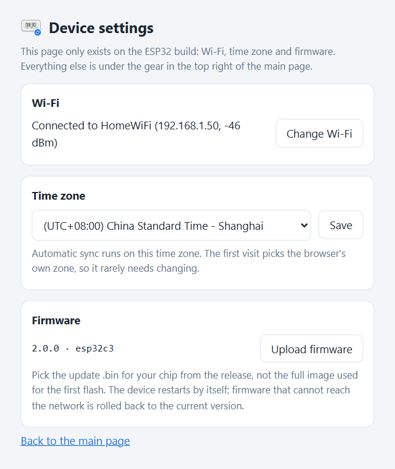

# LYWSD02 Clock Sync

[简体中文](README.zh-CN.md) | [繁體中文](README.zh-TW.md) | English

Xiaomi Mijia e-ink Bluetooth thermometers are not online, so their clock can only be set from the Mi Home app, and after a month or two it is a few minutes off. This project sets the clock over Bluetooth Low Energy (BLE) on a schedule. It runs on a PC or NAS, or on an ESP32-C3 board.

- One row per device in a web page: device time, drift, temperature, humidity, battery and signal, each row with its own Read and Sync buttons
- Automatic sync, weekly by default; a run missed while the machine was off happens at the next start
- Clocks are set from the local system clock or from an NTP server of your choice
- Windows, Linux (including NAS systems such as fnOS) and ESP32-C3; the installers bundle their own runtime
- Several machines form a cluster on their own: each device is handled by the machine with the best signal, and any page can operate every device
- English, 简体中文 and 繁體中文, dark and light themes

<picture>
  <source media="(prefers-color-scheme: dark)" srcset="docs/images/main-en-dark.png">
  
</picture>

## Contents

- [Supported devices](#supported-devices)
- [Requirements](#requirements)
- [Install](#install)
- [Usage](#usage)
- [Running several machines as a cluster](#running-several-machines-as-a-cluster)
- [Managing the service](#managing-the-service)
- [Configuration](#configuration)
- [HTTP API](#http-api)
- [Protocol](#protocol)
- [Security](#security)
- [Troubleshooting](#troubleshooting)
- [Uninstall](#uninstall)
- [Running from source](#running-from-source)

## Supported devices

| Model | Product ID | Hardware | Verified firmware | Time value length |
| --- | --- | --- | --- | --- |
| LYWSD02 | `0x045B` | `F2_LN` | `1.1.2_0097` | 5 bytes |
| LYWSD02MMC | `0x2542` | `F4_QT` | `2.0.1_0021` | 7 bytes |
| LYWSD02MMC | `0x16E4` | — | — | Recognised by product ID, not tested |

All of them are the square e-ink Mijia thermometers with a clock. Both value lengths are handled automatically.

LYWSDCGQ (round, no clock) and LYWSD03MMC (no clock on screen) are not supported.

To check whether yours works, follow these steps. Nothing is written to the device:

1. In the Mi Home app, open the device info. The model should be `LYWSD02` or `LYWSD02MMC`. Note the MAC address too.
2. After installing, open the web page and click **Scan**. Within about 25 seconds that MAC should show up in the table.
3. Click **Read** on that row. If **Device time** and **Model** both have values, the clock can be synced.

If it never shows up, see [Troubleshooting](#troubleshooting).

## Requirements

| Platform | Requirement | Notes |
| --- | --- | --- |
| Windows | Windows 10 1709 or later, x64 | The ARM64 installer is experimental. The service runs in your signed-in user session |
| Linux | glibc 2.36+, BlueZ 5.43+, amd64 or arm64 | Debian 12+, Ubuntu 23.04+, Raspberry Pi OS bookworm+, fnOS and other systemd distributions |
| ESP32 | ESP32-C3 with 4 MB flash | 2.4 GHz Wi-Fi only. The one-click flash script needs a Windows PC |
| macOS | — | No installer; you can [run from source](#running-from-source). Untested |

## Install

Download the file for your platform from [Releases](../../releases):

| Platform | File |
| --- | --- |
| Windows x64 | `LYWSD02ClockSync-Setup-<version>-x64.exe` |
| Windows ARM64 (experimental) | `LYWSD02ClockSync-Setup-<version>-arm64.exe` |
| Linux x86_64 | `lywsd02-clock-sync_<version>_amd64.deb` |
| Linux 64-bit ARM (Raspberry Pi 4/5, ARM NAS) | `lywsd02-clock-sync_<version>_arm64.deb` |
| ESP32-C3 | `LYWSD02-Clock-Sync-ESP32-<version>-windows.zip` |

To upgrade, install the new version over the old one. Settings and device labels are kept. Keep every machine in a cluster on the same version.

### Windows

1. Double-click `LYWSD02ClockSync-Setup-<version>-x64.exe` and click Yes at the UAC prompt.
2. Pick the language, install location and web port, then click **Install**.
3. When it finishes, click **Open web page**.

The installer is not code-signed. If SmartScreen says "Windows protected your PC", click **More info** → **Run anyway**.

The window has two options:

- **Run in the background when I sign in to Windows**: with this off, start the program from the Start menu and click **Start**.
- **Let other devices on the network connect**: adds a firewall rule for the web port and UDP 8788, which nodes use to find each other. Turn it off if you only use this PC.

The program goes to `%LocalAppData%\Programs\LYWSD02ClockSync` by default, and settings and data to `%LocalAppData%\LYWSD02ClockSync`.

The service is a scheduled task that starts when you sign in, not a Windows service, because the Windows Bluetooth API does not work in Session 0 where services run. Install it from the account you normally use, and do not enter a different administrator account at the UAC prompt.

For bulk deployment there is a silent install. It needs administrator rights:

```powershell
.\LYWSD02ClockSync-Setup-<version>-x64.exe --silent --port 8787 --language en
```

| Option | Meaning |
| --- | --- |
| `--silent` | Install without showing a window |
| `--dir <folder>` | Install location |
| `--port <port>` | Web port |
| `--language <code>` | `zh-CN`, `zh-TW` or `en` |
| `--no-autostart` | Do not run at sign-in |
| `--no-firewall` | Do not add the firewall rule |

Anything not given keeps the value of the existing install. Exit code `0` means the install succeeded and the service answered. The log is `%TEMP%\LYWSD02ClockSync-setup.log`.

### Linux

```bash
sudo apt install ./lywsd02-clock-sync_<version>_amd64.deb
```

`apt` pulls in `bluez` as well. The `lywsd02-clock-sync` service is then running and enabled at boot, and the web page is at `http://<this machine>:8787`.

| Path | Contents |
| --- | --- |
| `/opt/lywsd02-clock-sync/` | Program |
| `/var/lib/lywsd02-clock-sync/` | Settings and device data |

Logs go to the journal: `journalctl -u lywsd02-clock-sync`.

If `ufw` or `firewalld` is active, the package opens the web port and UDP 8788 on install and removes the rules on uninstall. After changing the port, run `sudo apt install --reinstall` once to update the rules. A NAS's built-in firewall has to be opened by hand.

The service runs as root. To use a normal user instead, add the user to the `bluetooth` group and set `User=` with `sudo systemctl edit lywsd02-clock-sync`.

On fnOS, enable SSH in the system settings first, sign in as an administrator and run the command above.

### ESP32-C3

A flashed board works on its own from any USB charger. It does everything the PC version does and can join a cluster with it.

1. Unzip `LYWSD02-Clock-Sync-ESP32-<version>-windows.zip`.
2. Connect the board to a Windows PC with a data-capable USB cable and double-click `flash.bat`. It finds the serial port, writes the firmware, then asks for your Wi-Fi name and password and hands them to the board over USB. You can also copy `wifi.example.txt` to `wifi.txt` and fill it in first; delete it afterwards.
3. Once connected, the window shows the web address, for example `http://192.168.1.50:8787/`. `http://ESP32-C3-XXXX.local:8787/` also works, where `XXXX` is the last 4 digits of the MAC address.

If the script cannot find the serial port or recognise the chip, hold the BOOT button while plugging the board back in and run it again.

Wi-Fi can also be set up without a PC. When the board has no Wi-Fi configured, or cannot reach the configured network for 3 minutes, it opens an open hotspot named after its hostname. Join it from your phone, open `http://192.168.4.1/`, pick your Wi-Fi and enter the password.

The ESP32 build has an extra device settings page at `http://<board address>:8787/config`, also linked from the settings on the main page:

- **Wi-Fi**: connection status and signal; change the network or hostname.
- **Time zone**: automatic sync runs on this zone. The first visit picks the browser's time zone.
- **Firmware**: to upgrade, upload the `-ota.bin` from the `firmware` folder. Settings are kept, and if the new firmware cannot get online the board goes back to the previous version.

<picture>
  <source media="(prefers-color-scheme: dark)" srcset="docs/images/config-en-dark.png">
  
</picture>

Running `flash.bat` again writes the full image and erases all settings, like a factory reset. `flash.bat -NoFlash` only changes the Wi-Fi without reflashing. `monitor.bat` shows the serial log and accepts debug commands; see `README.txt` in the zip.

Without Windows, write the full image to `0x0` with [esptool](https://github.com/espressif/esptool) and set up Wi-Fi through the hotspot:

```bash
esptool --chip esp32c3 write-flash 0x0 lywsd02-clock-sync-<version>-esp32c3-full.bin
```

## Usage

Open `http://<address>:8787` in a browser.

1. Click **Scan**. Nearby devices appear in the table within about 25 seconds.
2. Click the pencil icon to give each one a name. Names are stored by MAC, so rescanning does not lose them.
3. Click **Sync** to write the time now. When **Drift** turns green with `+0s` or `-1s`, it worked.
4. Leave the **Auto sync** switch on for devices that should be synced on schedule.

**Read all** reads time, temperature, humidity and battery from every device without writing anything. Sensor values only update on Read or Sync. There is no background polling, because every connection drains the coin cell.

Bluetooth can only do one thing at a time, so scans, reads and syncs queue up, with progress shown at the top. The bottom of the page shows the log from every node.

The language menu is at the top right, and the gear next to it opens the settings: appearance, node, listen address and port, sync schedule, time source and Bluetooth timeouts. Changing the listen address or port needs a service restart; everything else takes effect on save. The appearance setting is stored in the browser only.

<picture>
  <source media="(prefers-color-scheme: dark)" srcset="docs/images/settings-en-dark.png">
  
</picture>

**Time source** defaults to this machine's clock. If that clock is unreliable or hard to adjust, pick an NTP server instead; it is queried before every read and sync. If the server cannot be reached, that sync is skipped and logged.

## Running several machines as a cluster

One Bluetooth adapter only reaches so far. Install a copy on a PC, NAS or ESP32 in each room and they find each other on the local network and work as one. There is no master: each node keeps its own data, and every page shows the devices of all nodes together.

Keep all nodes on the same version.

### Finding other nodes

| Method | Port | Notes |
| --- | --- | --- |
| UDP broadcast | 8788 | Automatic within one subnet, nothing to set up |
| Typed by hand | Web port | Enter `192.168.1.20`, `192.168.1.20:8787` or a hostname under **Nodes typed by hand** in the settings |

Use the manual list when AP isolation, a guest network or a firewall blocks broadcasts. Entering the other machine's address on one side is enough for both to see each other.

Set each node's name under **Name of this node**; empty means the hostname. The node cards above the table show how many devices each node handles; click a card to open that node's page.

### Which node handles which device

Each device is handled by the node that hears it loudest, shown in the **Node** column. Signal strength is rounded to 6 dBm before comparing, so a difference of a dBm or two does not flip ownership back and forth. You can also pick a node in that column to pin the device to it.

Clicking **Sync** for a device on any page forwards the request to the node that handles it. On schedule, each node syncs only its own devices, so no clock gets synced several times.

### One operation at a time

Every operation locks the whole cluster. Until it finishes, buttons on other pages are greyed out and scheduled runs on other nodes wait. Nodes that cannot be reached do not take part, so a PC that is switched off cannot block the cluster. If the node holding the lock drops out, the lock is released after 30 seconds.

### When a node is offline

Devices handled by an offline node stay with it, and their **Read** and **Sync** buttons are disabled. Labels and the Auto sync switch can still be changed from any page and are synced when the node returns.

If the handling node has been offline for more than 26 hours, another node that can hear the device takes it over. Pinned devices are never taken over.

### With only one machine

Turn off **Work with other machines** in the settings to stop probing and broadcasting; the page then hides everything about nodes. To stop UDP broadcasts but keep the manual list, turn off only **Find other nodes automatically**.

When no page is open, nodes probe each other less often and use almost nothing while idle.

## Managing the service

**Windows**: open "LYWSD02 Clock Sync" from the Start menu. The window can open the web page, start or stop the service, open the data folder and uninstall. If the service fails to start, the reason is in `server.log` in the data folder.

From the command line:

```powershell
schtasks /Run /TN LYWSD02ClockSync      # start
schtasks /End /TN LYWSD02ClockSync      # stop
```

**Linux**:

```bash
sudo systemctl restart lywsd02-clock-sync    # restart
sudo systemctl stop lywsd02-clock-sync       # stop
journalctl -u lywsd02-clock-sync -f          # follow the log
```

**ESP32**: check the status on the `/config` page, or watch the serial log with `monitor.bat`. Unplug and replug to restart.

## Configuration

Everything in the settings is saved to `config.json` in the data folder, so there is usually no need to edit it. If you do, stop the service first and write only the keys you want to change; missing keys use their defaults. The ESP32 keeps its settings on the board and can only be configured through the web page.

| Platform | Data folder |
| --- | --- |
| Windows | `%LocalAppData%\LYWSD02ClockSync` |
| Linux | `/var/lib/lywsd02-clock-sync` |
| From source | The source folder, or the folder in the `LYWSD02_DATA_DIR` environment variable |

| Key | Default | Meaning |
| --- | --- | --- |
| `language` | `"zh-CN"` | UI language: `zh-CN`, `zh-TW`, `en` |
| `host` | `"0.0.0.0"` | Listen address; needs a restart |
| `port` | `8787` | Web port; needs a restart |
| `node.name` | `""` | Node name; empty means the hostname |
| `node.peers` | `[]` | Nodes typed by hand, e.g. `["192.168.1.20", "nas:8787"]` |
| `node.cluster` | `true` | Work with other machines |
| `node.discovery` | `true` | UDP broadcast discovery |
| `schedule.mode` | `"weekly"` | `weekly`, `daily` or `off` |
| `schedule.weekday` | `6` | `0` is Monday, `6` is Sunday |
| `schedule.hour` | `4` | Hour, local time |
| `schedule.minute` | `0` | Minute |
| `time_server` | `""` | Time source; empty means the local clock, or an NTP server such as `"pool.ntp.org"` |
| `bluetooth.scan_timeout` | `25.0` | Scan window, seconds |
| `bluetooth.connect_timeout` | `20.0` | Connect timeout, seconds |
| `bluetooth.env_timeout` | `15.0` | Sensor wait, seconds |
| `bluetooth.retries` | `3` | Connection attempts per device |

The same folder holds two files the service maintains; do not edit them. `devices.json` stores each device's label, switches and last reading. `state.json` stores the node identity and the time of the last scheduled run. Copying `config.json` to another machine does not copy the node identity.

## HTTP API

| Method | Path | Purpose |
| --- | --- | --- |
| `GET` | `/api/state` | Devices, nodes, queue and schedule |
| `POST` | `/api/scan` | Scan on all nodes |
| `POST` | `/api/read` | Every node reads the devices it handles |
| `POST` | `/api/devices/{key}/refresh` | Read one device |
| `POST` | `/api/devices/{key}/sync` | Sync one device |
| `PATCH` | `/api/devices/{key}` | Change `label`, `auto`, `owner_pin` |
| `POST` | `/api/logs` | Fetch logs; a body of `{}` returns the latest entries |
| `POST` | `/api/logs/clear` | Clear the logs |
| `GET` / `PUT` | `/api/settings` | Read or save settings |
| `PUT` | `/api/language` | Change the UI language |

`{key}` is the MAC address without colons. Queued requests return at once; see `/api/state` and the logs for results. Devices owned by another node are forwarded to it automatically. `/api/node/*` is used between nodes. The ESP32 also has `/api/wifi`, `/api/timezone` and `/api/ota` for its device settings page.

```bash
curl -s http://127.0.0.1:8787/api/state
curl -X POST http://127.0.0.1:8787/api/devices/A4C138000001/sync
curl -X PATCH http://127.0.0.1:8787/api/devices/A4C138000001 \
  -H 'Content-Type: application/json' -d '{"label":"Bedroom","auto":true}'
```

## Protocol

Everything here was verified on real devices. The clock service is `ebe0ccb0-7a0a-4b0c-8a1a-6ff2997da3a6`.

**Time `ebe0ccb7`**

| Bytes | Type | Meaning |
| --- | --- | --- |
| 0–3 | uint32 LE | Unix timestamp, UTC |
| 4 | int8 | Time zone in whole hours; UTC+8 is `0x08` |
| 5–6 | — | LYWSD02MMC only; read and written back unchanged |

For zones that are not whole hours (such as UTC+5:30), the remainder is folded into the timestamp. The LYWSD02MMC only accepts writes with response (ATT Write Request).

**Sensor `ebe0ccc1`**

| Bytes | Type | Meaning |
| --- | --- | --- |
| 0–1 | int16 LE | Temperature × 100, °C |
| 2 | uint8 | Relative humidity, % |
| 3–4 | uint16 LE | Battery voltage × 1000, V |

On the LYWSD02 this characteristic reads empty; values only arrive as notifications.

**Others**: `ebe0ccc4` battery percentage, `2a24` model, `2a26` firmware version, `2a27` hardware version, `2a25` serial number.

The device name cannot be changed over BLE, and the device ID in Mi Home is assigned by Xiaomi's cloud and cannot be read from the device, so devices are identified by MAC. The only characteristic this project writes is `ebe0ccb7`; **Read** writes nothing.

## Security

There is no authentication. Anyone who can reach the port can change labels and device clocks. Nodes do not authenticate each other either.

- Use it only on a trusted home network. Do not expose it to the internet or forward the port.
- To use it from this machine only, set the listen address to `127.0.0.1`. The cluster then stops working.

This project reads and writes over an active connection and does not need Xiaomi's bindkey.

## Troubleshooting

**A scan only finds some devices**

The Mi Home app holds the connection while it is in the foreground. Close it on every phone nearby, raise the scan window to 40 seconds in the settings and scan again. A device that is too far away will not show up either; install another node closer to it.

**Linux finds no devices at all**

```bash
bluetoothctl list               # is there a controller?
systemctl status bluetooth      # is BlueZ running?
rfkill list bluetooth           # is it blocked?
```

**The page opens on this machine but not from others**

Make sure the listen address in the settings is `0.0.0.0`, then check the firewall. On Windows, run Setup again with the network option ticked. On Linux, check `ufw status` or `firewall-cmd --list-ports`.

**Another node never shows up**

Open `http://<other machine>:8787/api/state` in a browser. If it does not load, the problem is the network or a firewall. If it loads, broadcasts are being blocked; add its address under **Nodes typed by hand**.

**The service is not running after a Windows restart**

It starts at sign-in, not at boot. Check that "Run in the background when I sign in to Windows" was ticked during install, or open the program from the Start menu and click **Start**.

**Drift comes back soon after a sync**

A device can only be as accurate as the time written to it. Check that this machine syncs its own clock, or set the time source to an NTP server.

**Temperature and humidity stay empty**

The LYWSD02 sends notifications on its own schedule. Raise the sensor wait in the settings. Missing sensor values do not affect syncing.

**The ESP32 page does not open**

Make sure your phone or PC is on the same network as the board. Some routers do not resolve `.local` names; use the IP instead, which you can find in the router or by typing `info` in `monitor.bat`.

**The ESP32 keeps its hotspot on**

It cannot join your Wi-Fi: the password is wrong, the network is 5 GHz, or the router is too far away. Join the hotspot and set up Wi-Fi again, or run `flash.bat -NoFlash`.

## Uninstall

**Windows**: uninstall from Settings → Apps → Installed apps, or click **Uninstall** in the program window. Tick "Also delete settings and device data" to remove the data folder; otherwise it is kept. Silent uninstall:

```powershell
& "$env:LOCALAPPDATA\Programs\LYWSD02ClockSync\LYWSD02ClockSync.exe" uninstall --silent          # keep data
& "$env:LOCALAPPDATA\Programs\LYWSD02ClockSync\LYWSD02ClockSync.exe" uninstall --silent --purge  # delete data
```

**Linux**:

```bash
sudo apt remove lywsd02-clock-sync    # keep data
sudo apt purge lywsd02-clock-sync     # delete data
```

**ESP32**: run `flash.bat` again to erase the settings, or just unplug it.

## Running from source

Needs Python 3.10+. On Linux the user must be able to reach BlueZ (root or the `bluetooth` group).

```bash
python -m venv .venv
.venv/bin/pip install -r requirements.txt      # Windows: .venv\Scripts\pip
.venv/bin/python app.py serve                  # Windows: .venv\Scripts\python
```

To build the installers yourself, run `python packaging/build.py`; output goes to `dist/`. PyInstaller cannot cross-compile, so build each platform and architecture on a matching machine. Build the deb on Debian 12 so it installs on any system with glibc 2.36+.

The ESP32 firmware builds with ESP-IDF v6.0.3:

```bash
cd esp32/node
idf.py set-target esp32c3
idf.py build
```

## Acknowledgements

Bluetooth is handled by [bleak](https://github.com/hbldh/bleak); the ESP32 build uses ESP-IDF and NimBLE. The `ebe0ccb7` time format was documented long ago by the Xiaomi BLE reverse-engineering community; this project verified it on real LYWSD02 and LYWSD02MMC units and added the 7-byte variant.

This is an unofficial project and is not affiliated with Xiaomi.

## License

[MIT](LICENSE)
