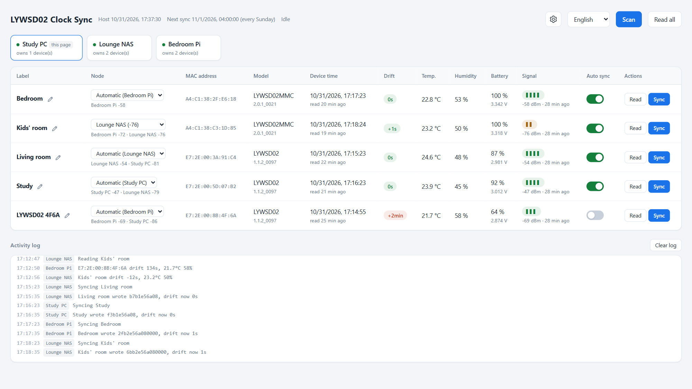
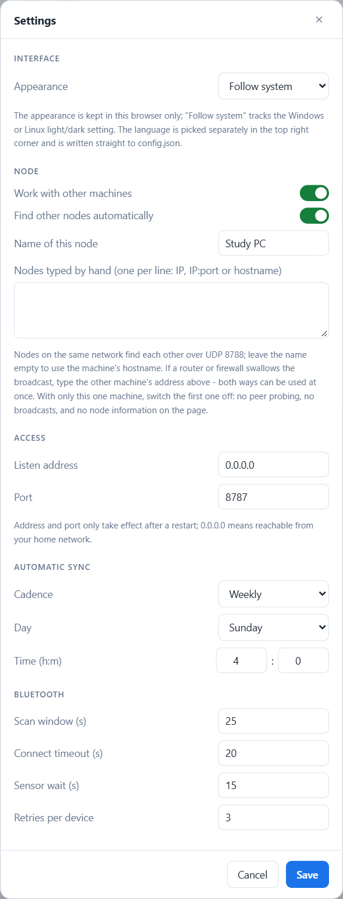

# LYWSD02 Clock Sync

[简体中文](README.zh-CN.md) | [繁體中文](README.zh-TW.md) | English

Keeps the clock on Xiaomi Mijia e-ink Bluetooth thermometers accurate from a PC
or NAS, on a schedule. No more correcting it by hand in the Mi Home app every
month or two.

These devices are not on the network. Only the Mi Home app on a phone can set
the clock, and left alone it drifts by a few minutes within a month or two. This
project connects over Bluetooth Low Energy (BLE) on a schedule and writes the
host's time to the device.

- Web UI with one row per device: label, MAC, model, device time, drift,
  temperature, humidity, battery, signal
- Each row has **Read** and **Sync** buttons and its own auto-sync switch
- Scheduled sync (weekly by default). If the machine was off when a sync was
  due, it catches up after it starts
- Several machines can form a cluster to cover the whole home. Any page can
  drive any device, and the machine with the best signal makes the connection
- Windows gets a graphical `Setup.exe` that shows the install live in its
  window. Linux gets a native `.deb` for amd64 and arm64. The runtime is
  bundled, so you don't need to install Python or any runtime libraries
- Sync cadence, listen address and Bluetooth timeouts can all be changed in the
  web settings
- Interface in 简体中文, 繁體中文 and English, switchable in the top right
- Dark and light theme, following the system by default
- The front end has no dependencies: no npm, no CDN

<picture>
  <source media="(prefers-color-scheme: dark)" srcset="docs/images/main-en-dark.png">
  
</picture>

## Table of contents

- [Supported operating systems](#supported-operating-systems)
- [Supported devices](#supported-devices)
- [Checking whether your device is supported](#checking-whether-your-device-is-supported)
- [Installation](#installation)
  - [Windows](#windows)
  - [Debian / Ubuntu / fnOS](#debian--ubuntu--fnos)
  - [Verifying the install](#verifying-the-install)
- [Usage](#usage)
- [Several machines, one cluster](#several-machines-one-cluster)
- [Managing the service](#managing-the-service)
- [Configuration](#configuration)
- [HTTP API](#http-api)
- [How it works](#how-it-works)
- [Protocol notes](#protocol-notes)
- [Security](#security)
- [Troubleshooting](#troubleshooting)
- [Uninstalling](#uninstalling)
- [Running from source and packaging](#running-from-source-and-packaging)
- [License](#license)

## Supported operating systems

Bluetooth access goes through [bleak](https://github.com/hbldh/bleak), so the
platform requirements are the same as bleak's.

| Platform | Minimum | Notes |
| --- | --- | --- |
| Windows | Windows 10 1709 (build 16299), x64 | Windows 11 recommended. The ARM64 installer is experimental. Must run in an interactive user session; see below. |
| Linux | glibc 2.36+, BlueZ 5.43+, amd64 or arm64 | Debian 12+, Ubuntu 23.04+, Raspberry Pi OS bookworm+, fnOS and other Debian-based distributions that use systemd. Needs D-Bus access to BlueZ. |
| macOS | 10.13 | No installer; [run from source](#running-from-source-and-packaging) only. Should work in theory. Not tested. |

The installers bundle their own Python runtime. You only need Python 3.10+ to
run from source or to build the packages yourself.

> **Windows:** the WinRT Bluetooth API does not work in session 0, where Windows
> services run. The installer therefore registers a scheduled task that starts
> **at logon** and runs in your user session. Do not turn it into a Windows
> service.

> **Linux:** the service talks to BlueZ over the system D-Bus. The systemd
> service in the deb runs as `root`, which is the easiest setup on a home
> server. To run it as an ordinary user, add the user to the `bluetooth` group
> and add `User=` with `sudo systemctl edit lywsd02-clock-sync`. Do not edit
> the file in `/usr/lib/systemd/system` directly. Upgrades overwrite it.

### Tested configurations

| Platform | Scan | Read clock / sensors | Write clock |
| --- | --- | --- | --- |
| Windows 11 Pro 25H2 (build 26200.9711) | passed | passed | not yet confirmed |
| fnOS 1.2.0800 x86_64 (Debian-based) | not yet tested | not yet tested | not yet tested |

Test results for other platforms are welcome. When you open an issue, include
the model and firmware version (shown in the **Model** column after a read) and
the activity log from the bottom of the page.

## Supported devices

| Model | Product ID | Hardware rev | Firmware verified | Time payload |
| --- | --- | --- | --- | --- |
| LYWSD02 | `0x045B` | `F2_LN` | `1.1.2_0097` | 5 bytes |
| LYWSD02MMC | `0x2542` | `F4_QT` | `2.0.1_0021` | 7 bytes |
| LYWSD02MMC | `0x16E4` | — | — | detected by product ID, untested |

All of them are the square e-ink "Mijia Bluetooth Thermometer/Hygrometer" with a
clock. Both payload lengths are handled automatically: the current value is read
before writing, and everything after the timezone byte is written back as it
was.

Other Xiaomi devices with the `ebe0ccb0` service may work. Add their product ID
to `KNOWN_PRODUCT_IDS` in [`lywsd02.py`](lywsd02.py), then
[run from source or rebuild the package](#running-from-source-and-packaging),
and a scan will recognise them.

**Not supported:** LYWSDCGQ (the round one without a clock), LYWSD03MMC (no
clock on the display), and any device whose clock Mi Home cannot set either.

## Checking whether your device is supported

Do these three steps in order. Step 3 is the one that decides. All three only
read; nothing is written to the device.

**1. Check the model in Mi Home**

Device → Settings (⚙) → Device info. The model should be `LYWSD02` or
`LYWSD02MMC`. Note the MAC address on the same page.

**2. Scan**

After [installing](#installation), open the web page and click **Scan**. After
about 25 seconds a row should appear with the same MAC as in Mi Home.

A device is recognised if any of these is true: its name contains `LYWSD02`; it
advertises the `ebe0ccb0` service; the product ID in its `fe95` service data is
in the table above. The tested LYWSD02MMC (`0x2542`) advertises neither a name
nor a service, so it is recognised by product ID alone.

If it never shows up, first read "Only some devices show up in a scan" under
[Troubleshooting](#troubleshooting). If that doesn't help, use a BLE tool on
your phone such as nRF Connect to find this MAC and look at its `fe95` service
data. Bytes 3 and 4, read little-endian, are the product ID. For example,
`30 58 42 25 …` is `0x2542`.

**3. Read once**

Click **Read** on that row. It connects, reads the time, temperature, humidity
and battery, and works out the drift, but writes nothing. If **Device time** has
a value and the **Model** column shows the model and firmware version, the time
characteristic `ebe0ccb7` exists and its format is understood. The device can be
synced. The format is a little-endian uint32 Unix timestamp plus a signed
timezone byte; see [Protocol notes](#protocol-notes).

Even if the device refuses the write, clicking **Sync** only logs a failure.
Nothing else happens.

## Installation

Download the installer for your platform from the [Releases](../../releases)
page:

| Platform | File |
| --- | --- |
| Windows x64 | `LYWSD02ClockSync-Setup-<version>-x64.exe` |
| Windows ARM64 (experimental) | `LYWSD02ClockSync-Setup-<version>-arm64.exe` |
| Debian / Ubuntu / fnOS, x86_64 | `lywsd02-clock-sync_<version>_amd64.deb` |
| 64-bit ARM Linux: Raspberry Pi 4/5, ARM NAS boxes, etc. | `lywsd02-clock-sync_<version>_arm64.deb` |

There is no installer for 32-bit ARM. You can
[run from source](#running-from-source-and-packaging) there.

At install time you only choose the port (and, on Windows, the language).
Everything else is set in the web page. To upgrade, install the new version.
Settings and device labels are kept.

### Windows

1. Download `LYWSD02ClockSync-Setup-<version>-x64.exe` and double-click it.
2. Click *Yes* in the UAC prompt. Registering the scheduled task and adding the
   firewall rule need administrator rights.
3. Choose the interface language, install location and web port, then click
   **Install**. The window ticks off each step as it runs, and **Show details**
   opens the full log. When it is done, click **Open web page**.

The installer is not code-signed, so on first run SmartScreen may say *Windows
protected your PC*. Click **More info** → **Run anyway**. If you'd rather not
trust it, [build it yourself](#running-from-source-and-packaging).

The window has two options:

- **Run in the background when I sign in to Windows**: the scheduled task starts
  the program at every sign-in. If it is off, the task is still registered, but
  the program only runs when you open it from the Start menu and click
  **Start**.
- **Let other devices on the network connect (adds a firewall rule)**: adds an
  inbound firewall rule for the program, covering the web port and UDP 8788 for
  node discovery. Leave it off if you only use it on this machine.

Setup runs these steps in order:

1. Stops the running service. If something other than this service answers on
   the port, setup stops here and tells you.
2. Unpacks the program into the install location, by default
   `%LocalAppData%\Programs\LYWSD02ClockSync`.
3. Writes the port and language into `config.json` in the data directory. Other
   settings are left unchanged.
4. Creates a Start menu shortcut and lists the program under Settings → Apps →
   Installed apps.
5. Adds the firewall rule `LYWSD02 Clock Sync`.
6. Registers and starts the scheduled task `LYWSD02ClockSync`, then waits up
   to 30 seconds to confirm that the web port answers.

Program and data are kept apart. Settings, device labels and `server.log` live
in `%LocalAppData%\LYWSD02ClockSync`. Upgrades don't touch it, and
uninstalling keeps it by default. The program installs into your user profile
rather than Program Files because the logon task runs without elevation and
cannot write to Program Files.

The scheduled task must belong to an **interactive** user. WinRT Bluetooth does
not work in session 0, so do not install as `SYSTEM` and do not turn the task
into a service. For the same reason, setup refuses to continue if the UAC prompt
was answered with the password of a different administrator account. Otherwise
the task and the data would end up under that account. Sign in to the account
you actually use and approve UAC from that account.

**Silent install** is meant for mass deployment. The installer always needs
administrator rights, so run it from an elevated terminal or accept the UAC
prompt:

```powershell
.\LYWSD02ClockSync-Setup-1.0.0-x64.exe --silent --port 8787 --language zh-CN
```

| Flag | Meaning |
| --- | --- |
| `--silent` | no window; install straight from the flags |
| `--dir <dir>` | install location |
| `--port <port>` | web port |
| `--language <code>` | interface language: `zh-CN`, `zh-TW` or `en` |
| `--no-autostart` | do not run at sign-in |
| `--no-firewall` | do not add the firewall rule |

A location, port or language you don't give keeps the value of the existing
install, or the default on a fresh install. If autostart was off before, it
stays off after an upgrade. The flags also work in window mode, where they
pre-fill the form. Exit code `0` means the install succeeded and the service
answered. The run is logged to `%TEMP%\LYWSD02ClockSync-setup.log`.

### Debian / Ubuntu / fnOS

```bash
sudo apt install ./lywsd02-clock-sync_1.0.0_amd64.deb
```

`apt` installs `bluez` as well if it is missing. `dpkg -i` also works, but it
does not install the recommended dependencies.

After install, the service `lywsd02-clock-sync.service` is running and
enabled at boot. The web page is at `http://<this machine>:8787`.

| Path | Contents |
| --- | --- |
| `/opt/lywsd02-clock-sync/` | the program |
| `/usr/lib/systemd/system/lywsd02-clock-sync.service` | the systemd service |
| `/var/lib/lywsd02-clock-sync/` | settings, device labels and scheduler records, managed by systemd's `StateDirectory=` |

The service's output goes to the journal, so there is no `server.log` on Linux.

If `ufw` or `firewalld` is active, the install opens the web port (TCP) and
UDP 8788 for node discovery, and removing the package closes them again. If
neither is active, nothing is changed. Any other firewall, including the
graphical firewall built into NAS systems, needs these two ports opened by you.
The port that gets opened is the one in `config.json` at install time. If you
change the port later, update the firewall rule yourself.

Upgrading: install the new deb with `sudo apt install`. The service restarts on
its own, and the data in `/var/lib` is not affected.

On fnOS, first enable SSH in the system settings, sign in with an administrator
account and run the command above. The fnOS file manager usually doesn't show
`/opt` or `/var/lib`. That is normal.

### Verifying the install

Windows: open *LYWSD02 Clock Sync* from the Start menu. The window should show
*Running* and the web address. You can also check from a terminal:

```powershell
schtasks /Query /TN LYWSD02ClockSync
Invoke-WebRequest http://127.0.0.1:8787/api/state | Select-Object -Expand Content
```

Linux:

```bash
systemctl status lywsd02-clock-sync
journalctl -u lywsd02-clock-sync -n 50
curl -s http://127.0.0.1:8787/api/state
```

## Usage

Open `http://<host>:8787` in a browser.

1. Click **Scan**. Devices in range appear in the table after about 25 seconds.
   A device without a label is shown as
   `LYWSD02 <last 4 MAC digits>`, in the current language.
2. Click the pencil icon to give it a name. Labels are keyed by MAC, so they
   survive restarts and rescans.
3. Click **Sync** to write the time now. The **Drift** column should change to a
   green `+0s` or `-1s`.
4. Keep the **Auto sync** switch on for each device the schedule should handle.

The header shows the host time and the next scheduled sync. The log at the
bottom shows the last 150 events from all nodes, each marked with the node it
came from.

With more than one machine, the strip above the table lists all nodes and how
many devices each one owns. The **Node** column shows which node is responsible
for each device. See [Several machines, one cluster](#several-machines-one-cluster).

The ⚙ button left of the language picker opens the settings: appearance, listen
address and port, sync cadence and Bluetooth timeouts. Saving writes
`config.json`. A new address or port needs a service restart; everything else
applies at once. Appearance is the exception. It is stored only in the browser,
and *Follow system* follows the Windows or Linux light/dark setting.

<picture>
  <source media="(prefers-color-scheme: dark)" srcset="docs/images/settings-en-dark.png">
  
</picture>

The picker in the top right switches between 简体中文, 繁體中文 and English. It
sits outside the settings because when you can't read the interface, changing
the language is the first thing you need. Picking a language writes `language`
in `config.json` right away. From then on every browser opens in that language,
and the Windows setup and manager windows use it too. Log lines are translated
in the browser, so switching language also translates the lines already on
screen.

Scanning and connecting run one at a time, because a Bluetooth adapter can't do
both at once. Requests are queued, and the header shows what is running.

Sensor data only refreshes when you click **Read** or **Sync**. There is no
background polling, because every connection drains the coin cell. **Read all**,
next to **Scan**, reads every device in one go: each node reads the devices it
owns, all at the same time, and the lock is released only when all are done. It
only reads, never writes, and it ignores the auto-sync switch.

## Several machines, one cluster

One Bluetooth adapter only reaches so far. Install a copy on each machine near
your devices, for example a desktop in the bedroom and a home server in the
living room. They find each other on the local network and work as one. There
is no master node and no shared database. Each node keeps its own
`devices.json`, and the page shows all devices known to any node.

Each node only uses its own Bluetooth adapter. If you click **Sync** on a device
owned by another node, the request is forwarded to that node. A forwarded
request is never forwarded again, so there is at most one hop.

### Node names and discovery

Give each machine a name in the settings, such as "Bedroom" or "Living room".
Leave it empty to use the hostname. If the box still holds the hostname when you
save, the stored value stays empty, so the node name follows if the machine is
renamed later. The name is stored in `config.json` and shown in the device table
and the log. The node's identity is a random id in `state.json`, so copying a
config file to another machine won't make two nodes look like the same one.

Two discovery methods run at the same time. Either one is enough:

| Method | Port | When it works |
| --- | --- | --- |
| UDP beacon | 8788 | Same subnet with broadcast allowed. Nothing to configure. A node that is silent for 150 seconds is removed. |
| Hand-typed | the web port | Always. Enter `192.168.1.20`, `192.168.1.20:8787` or `nas` under *Nodes typed by hand* in the settings. |

Use the hand-typed list when broadcast is blocked (guest VLANs, AP isolation, a
firewall that only opens the TCP port). A node found by both methods counts
once.

The beacon goes out every 10 seconds while a page is open and every 60 seconds
when nobody is looking. A beacon from an unknown address gets an immediate
reply, so a new node shows up without waiting a minute, even when both sides are
on the slow cadence.

When a node probes another, it sends its own web port along, and the other node
adds it to its list. So typing an address on one machine is enough for both to
see each other. This also works when broadcast only gets out one way, for
example a NAS that only sends from one network interface. If port 8788 is in
use, the node logs it once and keeps retrying in the background. Hand-typed
nodes are not affected.

To try a cluster on one machine, start several copies of the service
[from source](#running-from-source-and-packaging). Point each one at its own
data directory with `LYWSD02_DATA_DIR`, and put a `config.json` there that only
sets a different `port`. Then add the other copies' `127.0.0.1:<port>` as
hand-typed nodes. They form a cluster like separate machines would, except that
only the first one gets the beacon port and they all share one Bluetooth
adapter. The installers can't do this. The service name is fixed, so it is one
install per machine.

### Which node drives which clock

Each node reports how strongly it hears each device, and the node with the
strongest signal owns it. Signals are rounded to 6 dBm steps before comparing.
This way all nodes reach the same result without coordinating, and a neighbour
has to be clearly closer to take a device over. A difference of one or two dBm
does not make ownership flip back and forth. The **Node** column shows the
owner, with each node's signal below. Each scan replaces that node's data as a
whole. A device it no longer hears drops out of its list instead of staying with
an old signal.

If the automatic choice doesn't suit you, pick a node in that column and the
device is pinned to it. A pinned device stays with that node even if another
node hears it better, and it is never taken over. The dropdown only lists nodes
that heard the device on their last scan; any other node could not connect. If
you move a device, scan again before changing the pin. If the pinned node later
stops hearing the device, it is marked *out of range* and kept until you change
it.

The schedule follows ownership. At the scheduled time each node only syncs the
devices it owns, so three nodes don't sync the same clock three times at 04:00.

### One operation at a time

A clock should only be written by one machine, and several adapters working at
once make the log hard to follow. So every operation locks the whole cluster.
The node starting an operation asks every node it can reach for the lock, and
starts only when all of them agree. Meanwhile anything else, such as a button on
another page or another node's schedule, is refused with a message naming the
busy node. Buttons on every page stay greyed out until it finishes.

Unreachable nodes don't vote. A machine that is off can't be using Bluetooth,
and giving it a veto would let one sleeping PC block the whole cluster. If the
lock holder drops out mid-operation, the lock is released after 30 seconds. A
stuck job holds it for at most 15 minutes.

### When a node is offline

An offline node keeps the devices it owned, because it is still the machine
physically closest to them. Reassigning them to an adapter that can barely hear
them would be worse. Those rows show an offline marker, and the **Read** and
**Sync** buttons are disabled.

Labels, the auto-sync switch and the pinned node are the exception. They can be
changed on any page and spread to the other nodes by timestamp, so you can
change them while a node is offline. When it comes back, the latest change wins.

A device whose owner has been offline for more than 26 hours is taken over by
another node that can hear it. A PC left off all weekend won't leave a clock
unsynced. Pinned devices are never taken over.

### Switching off what you don't use

On a single machine the cluster features are not needed. The settings have two
switches for two keys in `config.json`:

| Switch | Key | When off |
| --- | --- | --- |
| Work with other machines | `node.cluster` | No node probing, no beacons, no node-to-node requests (`/api/node/*` all return 503). The page hides the node strip and the **Node** column |
| Find other nodes automatically | `node.discovery` | The cluster still works, but it stops sending and receiving UDP beacons and releases port 8788. Nodes come only from the hand-typed list |

Scheduled sync can be turned off too. Set the schedule to **Off** and the
scheduler never touches Bluetooth.

The other power-saving measures are automatic:

- Node probing has three tiers: every 2 seconds while a page is open, every 60
  seconds when there are nodes but nobody is looking, and every 300 seconds when
  no node has ever answered. When idle, probes per node per day drop from 43,200
  to 1,440.
- A page in a background tab stops polling and refreshes once as soon as you
  switch back, so a forgotten tab doesn't keep waking that machine.
- A node that has been unreachable for more than 30 seconds is probed at most
  once a minute instead of on every refresh, so a machine that is off doesn't
  slow the page down. With one node down, the first request went from 1.5
  seconds to a few milliseconds. As soon as its beacon or probe arrives, it is
  back to normal.
- The page only redraws the parts that changed. An idle refresh went from about
  22 ms of browser work to about 1 ms.
- Slow probing only affects how fresh the table is. It does not affect
  correctness: every action and every lock request forces a round of probes
  first, so nothing acts on an outdated node list.
- At the scheduled time, a node first checks what it already knows to see if it
  has any device to sync. If not, it skips the slot without taking the lock or
  scanning. The one exception: if this machine's Bluetooth has never heard any
  device on the list, only a scan can tell whether one is nearby, so it scans as
  usual.

## Managing the service

**Windows:** opening *LYWSD02 Clock Sync* from the Start menu brings up the
manager window. It refreshes the service status every two seconds:

| Button | What it does |
| --- | --- |
| Open web page | opens the web page in the default browser |
| Start / Stop | starts or stops the scheduled task, and waits until the port answers or has been released |
| Open data folder | opens `%LocalAppData%\LYWSD02ClockSync` |
| Uninstall | opens the uninstall window; see [Uninstalling](#uninstalling) |

If the port doesn't answer within 25 seconds of clicking **Start**, a failure is
reported. The reason is in `server.log` in the data directory. The service has
no console, so startup errors are written to that file.

You can also drive the scheduled task directly:

```powershell
schtasks /Run /TN LYWSD02ClockSync      # start
schtasks /End /TN LYWSD02ClockSync      # stop
```

**Linux:**

```bash
sudo systemctl start lywsd02-clock-sync
sudo systemctl stop lywsd02-clock-sync
sudo systemctl restart lywsd02-clock-sync    # after changing the listen address or port
sudo systemctl disable lywsd02-clock-sync    # stop starting at boot
journalctl -u lywsd02-clock-sync -f          # follow the log
```

## Configuration

### `config.json`

Every setting lives here. It sits in the data directory together with
`state.json` and `devices.json` below, not in the program directory:

| Platform | Data directory |
| --- | --- |
| Windows | `%LocalAppData%\LYWSD02ClockSync` |
| Linux | `/var/lib/lywsd02-clock-sync` |
| Running from source | the source directory itself |

If the environment variable `LYWSD02_DATA_DIR` is set, it takes precedence.

If the file or any key is missing, the default is used, so you only need to
write the keys you want to change. The web settings write this same file. Stop
the service before editing it by hand, or the next save from the web page will
overwrite your changes. `host` and `port` take effect after a restart;
everything else applies immediately.

| Key | Default | Meaning |
| --- | --- | --- |
| `language` | `"zh-CN"` | language of the web page and the Windows setup and manager windows, also set by the picker: `zh-CN`, `zh-TW`, `en` |
| `host` | `"0.0.0.0"` | listen address |
| `port` | `8787` | listen port |
| `node.name` | `""` | this node's name in the table and the logs; empty means the hostname |
| `node.peers` | `[]` | hand-typed nodes, e.g. `["192.168.1.20", "nas:8787"]` |
| `node.cluster` | `true` | off means single-machine mode: no node probing, no beacons, no node-to-node requests |
| `node.discovery` | `true` | off only stops the UDP beacon; hand-typed nodes still work |
| `schedule.mode` | `"weekly"` | `weekly`, `daily` or `off` |
| `schedule.weekday` | `6` | `0` = Monday … `6` = Sunday |
| `schedule.hour` | `4` | local hour |
| `schedule.minute` | `0` | local minute |
| `bluetooth.scan_timeout` | `25.0` | seconds per scan |
| `bluetooth.connect_timeout` | `20.0` | seconds to wait for a connection |
| `bluetooth.env_timeout` | `15.0` | seconds to wait for a sensor notification |
| `bluetooth.retries` | `3` | connection attempts per device |

### `state.json`

Scheduler records, written by the service. `last_auto_run` is the Unix timestamp
of the last automatic sync, `node_id` is this node's random identity, and
`nodes` holds the node ids it has seen and their names. Deleting the file clears
these records. Do not edit it by hand. It is a separate file so that scheduler
records never touch your settings, and so that copying `config.json` to another
machine doesn't copy the node identity with it.

### `devices.json`

Created and maintained by the service. The key is the MAC address without
separators. You set `label` and `auto`; the rest is a cache of the last reading.

```json
{
  "A4C13877596D": {
    "address": "A4:C1:38:77:59:6D",
    "label": "Hallway",
    "auto": true,
    "rssi": -67,
    "last": {
      "model": "LYWSD02MMC",
      "firmware": "2.0.1_0021",
      "temperature": 24.13,
      "humidity": 60,
      "drift": -1
    }
  }
}
```

All three files are written atomically (temporary file, then `os.replace`), so a
power cut can't leave a half-written file behind.

When you run from source they sit in the source directory, so they are all
listed in `.gitignore`. `devices.json` contains your device MAC addresses. Don't
commit it.

## HTTP API

| Method | Path | Purpose |
| --- | --- | --- |
| `GET` | `/api/state` | everything the page needs: devices, nodes, lock, queue, schedule, logs, language |
| `GET` | `/api/ping` | only says the service is up; unlike `/api/state` it does not count as someone looking |
| `POST` | `/api/scan` | queue a scan, here and on every reachable node |
| `POST` | `/api/read` | every reachable node reads the devices it owns |
| `POST` | `/api/devices/{key}/refresh` | queue a read of clock and sensors |
| `POST` | `/api/devices/{key}/sync` | queue a clock write |
| `PATCH` | `/api/devices/{key}` | `{"label": "...", "auto": true, "owner_pin": "<node id>"}` |
| `POST` | `/api/logs/clear` | clear the in-memory activity log |
| `GET` | `/api/settings` | the settings that can be changed in the settings |
| `PUT` | `/api/settings` | save them all; returns `{"restart_required": bool}` |
| `PUT` | `/api/language` | used by the language picker: `{"language": "zh-CN"}` |

`{key}` is the MAC address without separators. The queueing `POST` endpoints
return `{"queued": true}` right away; check `/api/state` for the result. A
device owned by another node is handled on that node. The caller doesn't need to
care.

Nodes talk to each other over a second, narrower set of endpoints. They only use
the node's own Bluetooth and never forward, so a request is at most one hop.
They are meant for node-to-node use and are plain JSON:

| Method | Path | Purpose |
| --- | --- | --- |
| `GET` | `/api/node/state` | what this node knows by itself |
| `POST` | `/api/node/lock` | claim the cluster lock; refused while this node is busy |
| `POST` | `/api/node/unlock` | release the cluster lock |
| `POST` | `/api/node/scan` | scan with this node's Bluetooth; needs the lock holder's token |
| `POST` | `/api/node/read` | read the devices this node owns; needs the lock holder's token |
| `POST` | `/api/node/devices/{key}/refresh` | read with this node's Bluetooth |
| `POST` | `/api/node/devices/{key}/sync` | write with this node's Bluetooth |
| `POST` | `/api/node/logs/clear` | clear this node's log |

Refusals carry a message key instead of a ready-made sentence, so each page
shows them in its own language:
`{"detail": {"event": "error.clusterBusy", "params": {...}}}`. A node with
**Work with other machines** turned off answers all of these with 503
`error.clusterOff`. The other page then shows a matching message instead of
just "unreachable".

```bash
curl -s http://127.0.0.1:8787/api/state | python -m json.tool
curl -X POST http://127.0.0.1:8787/api/devices/A4C13877596D/sync
curl -X PATCH http://127.0.0.1:8787/api/devices/A4C13877596D \
  -H 'Content-Type: application/json' -d '{"label":"Hallway","auto":true}'
```

## How it works

```
app.py           entry point: serve runs the service; on Windows, no arguments
                 opens the manager window
paths.py         where the program's resources and the data directory are
lywsd02.py       BLE protocol: scan, product-ID matching, time encode/decode,
                 payload-width-aware write, sensor and identity reads
store.py         atomic JSON writes
cluster.py       node identity, discovery, the cluster lock, ownership merge
server.py        FastAPI app, serial job queue, scheduler, REST endpoints
static/          single-page front end, vanilla JS, no external requests
  index.html     markup, styling and rendering
  i18n.js        zh-CN / zh-TW / en strings
  icon.png       page icon
winsetup.py      Windows setup, manager and uninstall windows (tkinter)
packaging/
  build.py       builds Setup.exe or the .deb on the current platform
  installer.py   entry point of Setup.exe
  linux/         systemd unit and the deb maintainer scripts
  icon.ico       program icon
VERSION          version number, read by packaging and releases
```

The backend never builds sentences for people to read. Log entries are sent as
an event name plus parameters (`{"event": "device.synced", "params": {...}}`),
and the browser turns them into text. So a language switch applies at once, and
the strings live in one place.

A Bluetooth adapter can't scan and connect at the same time, so `server.py` puts
every operation in a single-consumer `asyncio.Queue`. A duplicate request for a
device that is already queued is dropped.

The scheduler checks once a minute and works out when the schedule should last
have fired. If `last_auto_run` in `state.json` is older than that, it runs at
once. A machine that was off on Sunday at 04:00 syncs right after it starts
instead of waiting another week. This works like `Persistent=true` on a systemd
timer.

On its first start the service sets `last_auto_run` to the current time. A fresh
install therefore doesn't treat the previous slot as missed and run at once. The
first automatic sync happens at the next scheduled time.

`cluster.py` adds no dependencies. Node-to-node calls use `urllib.request` on a
worker thread, and discovery uses UDP broadcast instead of mDNS. This avoids one
more package on machines that struggle to reach PyPI. Device data is merged per
field, and the last write wins. If two nodes change the same label at the same
time, the later change wins, with no transaction needed.

Only requests to `/api/state` count as someone looking. Probes between nodes
don't count. Otherwise two idle machines probing each other would keep each
other on the fastest tier. The two background loops each have their own wake
event. If they shared one, whichever woke first would swallow the other's
signal.

## Protocol notes

Everything below was verified on real hardware. The Mijia clock service is
`ebe0ccb0-7a0a-4b0c-8a1a-6ff2997da3a6`.

### Time: `ebe0ccb7`

| Bytes | Type | Meaning |
| --- | --- | --- |
| 0–3 | uint32 little-endian | Unix timestamp, UTC |
| 4 | int8 | timezone offset in whole hours (`0x08` for UTC+8) |
| 5+ | — | only on LYWSD02MMC (`0x0000`); read and written back unchanged |

The timezone field only holds whole hours, so offsets like UTC+5:30 fold the
remainder into the timestamp:

```python
offset = time.localtime(now).tm_gmtoff
struct.pack("<Ib", int(now) + offset % 3600, offset // 3600)
```

On LYWSD02MMC, `ebe0ccb7` has the properties `[write,read]` and does not
support write-without-response. Writes must use an ATT Write Request (opcode
`0x12`, `response=True` in bleak). A Write Command (`0x52`) does not work.

### Sensors: `ebe0ccc1`

| Bytes | Type | Meaning |
| --- | --- | --- |
| 0–1 | int16 little-endian | temperature × 100, °C |
| 2 | uint8 | relative humidity, % |
| 3–4 | uint16 little-endian | battery voltage × 1000, V |

LYWSD02MMC can be read directly. On LYWSD02 a read returns empty data, and the
values only arrive by notification. So the code reads first and subscribes to
notifications if the read comes back empty.

### Other characteristics

| UUID | Meaning |
| --- | --- |
| `ebe0ccc4` | battery percentage (uint8) |
| `2a24` | model number, e.g. `LYWSD02MMC` |
| `2a25` | serial number, unique and stable |
| `2a26` | firmware revision |
| `2a27` | hardware revision, e.g. `F4_QT` |
| `2a23` | System ID; the first 6 bytes in reverse order are the MAC |

### Device identity

`2a00` (Device Name) is read-only, so devices can't be renamed over BLE. The
`设备 ID` (`blt.3.…`) in Mi Home is assigned by Xiaomi's cloud and can't be read
from the device. The CMIIT ID identifies the model, not the individual unit. The
only stable identifiers on the device are the MAC address and the serial number,
so this project keys labels by MAC.

### Do not write blindly

`ebe0ccd2` seems to hold a pairing or binding code. Writing to characteristics
whose purpose you don't know may mean re-pairing the device in Mi Home. This
project only writes the `ebe0ccb7` characteristic, and the **Read** button
writes nothing.

## Security

The service has **no authentication**. Anyone who can reach the port can change
labels and set device clocks.

- `0.0.0.0` is only suitable for a trusted home LAN.
- In any other case, change the listen address to `127.0.0.1` in the settings
  (on Windows, also turn off the firewall option when installing) and connect
  through an SSH tunnel.
- Do not expose the port to the internet, and do not set up port forwarding for
  it.
- Nodes don't authenticate each other either. They trust each other only because
  they are on the same network, so the cluster is as safe as your network.
  Binding to `127.0.0.1` turns the cluster off, since no other node can be
  reached.

Encrypted Xiaomi `fe95` advertisements (the bindkey mechanism) only matter for
**passive** decoding of broadcast data. This project uses active GATT reads and
writes, so no bindkey is needed.

## Troubleshooting

**Nothing happens after double-clicking Setup.exe**

Most likely *No* was clicked in the UAC prompt. Double-click it again. If
SmartScreen says *Windows protected your PC*, click **More info** → **Run
anyway**. The installer is not code-signed, and new releases with few downloads
get this prompt.

**Setup stops at the first step, saying something else answers on the port**

Another program holds the port, most likely a service started by hand from
source. Close it, or install with a different port.

**Setup says it is running as a different account**

The UAC prompt was answered with another administrator account. The scheduled
task and the data must belong to the account that actually uses the program.
Sign in to that account and approve UAC in its session.

**The page works locally but not from another machine**

In the settings, check that the listen address is `0.0.0.0` and not
`127.0.0.1`. Then check the firewall rule. On Windows, use
`netsh advfirewall firewall show rule name="LYWSD02 Clock Sync"`. If the rule
is missing, run Setup again with the firewall option on. On Linux, use
`ufw status` or `firewall-cmd --list-ports`. A NAS's built-in firewall has to be
checked in its admin interface.

**Another node never appears in the node strip**

First open `http://<other machine>:8787/api/node/state` in a browser. If that
fails, the network is the problem, not discovery. If it returns 503
`error.clusterOff`, that machine has **Work with other machines** turned off.
Turn it on in its settings. If the page opens but the node still doesn't appear,
the UDP beacon is blocked, for example by AP isolation, a guest VLAN, or a
firewall that only opens the TCP port. Enter that machine's address under
*Nodes typed by hand* in the settings. This goes through the web port and
doesn't need broadcast.

**Only some devices show up in a scan**

The Mi Home app holds a connection while it is in the foreground or just after
it goes to the background. Force-stop Mi Home on every phone nearby, set
*Scan window (s)* to 40 in the settings and scan again. A device that is busy
with another connection doesn't answer scans.

**`BleakDeviceNotFoundError` on connect**

A device has to be seen in a scan before it can be connected. Before every
connection the service looks up the address again, and only tries the raw
address if that finds nothing. On Linux,
`BleakError("device 'dev_A4_C1_38_..' not found")` means BlueZ has removed the
unpaired device from D-Bus. It does this about half a minute after scanning
stops. Looking it up again fixes it; no restart needed.

**No devices found at all on Linux**

```bash
bluetoothctl list                 # is there a controller?
systemctl status bluetooth        # is BlueZ running?
rfkill list bluetooth             # is it soft-blocked?
```

If the service runs as a non-root user, it needs D-Bus access to BlueZ. Add the
user to the `bluetooth` group, or run as root.

**The service is not running after a Windows reboot**

The scheduled task runs **at logon**, not at boot. If *Run in the background
when I sign in to Windows* was off during setup, it won't start on its own.
Check with `schtasks /Query /TN LYWSD02ClockSync /V /FO LIST`. Running without
signing in won't work, because WinRT Bluetooth mostly fails in session 0.

**The install succeeded but the browser says the connection was refused**

The service is registered but not listening. On Windows, first click **Start**
in the manager window. If that doesn't help, check:

```powershell
Get-ScheduledTask LYWSD02ClockSync | Get-ScheduledTaskInfo           # did it run? what did it return?
Get-Content "$env:LOCALAPPDATA\LYWSD02ClockSync\server.log" -Tail 40   # why did it exit?
```

On Linux, check `journalctl -u lywsd02-clock-sync -n 50`.

**Drift comes back soon after a sync**

Check the host clock first. The device can only be as accurate as the machine
that writes to it. Make sure NTP is enabled (`w32tm /query /status` on Windows,
`timedatectl` on Linux).

**Drift is still large after a sync**

If the write succeeds but the value read back is still wrong, the payload length
may not be what was expected. Please post the model, firmware version and
activity log in an issue.

**Temperature and humidity stay empty**

On LYWSD02, a read of `ebe0ccc1` returns empty data, and the device only sends
notifications on its own schedule. If `sensor read failed` keeps showing up in
the log, raise *Sensor wait (s)* in the settings. Missing sensor data does not
affect syncing.

**The e-ink display lags behind**

The e-ink panel refreshes on its own schedule. The value read over BLE is the
one to trust. The display usually catches up within a minute.

## Uninstalling

**Windows:** uninstall it from Settings → Apps → Installed apps, or click
**Uninstall** in the manager window. Uninstalling stops the service, removes the
scheduled task, the firewall rule, the Start menu shortcut and the uninstall
entry, and finally deletes the program files. The program itself is running, so
that last step finishes after the window closes.

Turning on *Also delete settings and device data* removes
`%LocalAppData%\LYWSD02ClockSync` as well. If it is off, it is kept, and a
reinstall picks it up again. Files you put in the program directory yourself are
not deleted, and in that case the directory stays too.

A silent uninstall also needs administrator rights, and shows a UAC prompt if it
doesn't have them:

```powershell
& "$env:LOCALAPPDATA\Programs\LYWSD02ClockSync\LYWSD02ClockSync.exe" uninstall --silent           # keep the data
& "$env:LOCALAPPDATA\Programs\LYWSD02ClockSync\LYWSD02ClockSync.exe" uninstall --silent --purge   # delete the data too
```

The run is logged to `%TEMP%\LYWSD02ClockSync-uninstall.log`.

**Linux:**

```bash
sudo apt remove lywsd02-clock-sync    # keeps /var/lib/lywsd02-clock-sync
sudo apt purge lywsd02-clock-sync     # deletes the data too
```

Both stop and disable the service and remove the `ufw` / `firewalld` rules added
at install time.

Nothing is written to the system-wide registry, and nothing on the device is
changed except the time.

## Running from source and packaging

### Running from source

You need Python 3.10+. On Linux you also need BlueZ, and the user running the
service must be able to reach it (root or the `bluetooth` group).

```bash
python -m venv .venv
.venv/bin/pip install -r requirements.txt      # Windows: .venv\Scripts\pip
.venv/bin/python app.py serve                  # Windows: .venv\Scripts\python
```

The data files go in the source directory. Set the environment variable
`LYWSD02_DATA_DIR` to put them somewhere else. On Windows, `python app.py` with no
arguments opens the manager window, which manages the installed copy, not the
source copy.

### Packaging

```bash
python packaging/build.py
```

The script creates a separate virtual environment, `build/venv`, installs the
dependencies and PyInstaller into it and builds from there. Other Python
packages on the machine can't end up in the installer. The output goes to
`dist/`:

| Platform | Output |
| --- | --- |
| Windows | `LYWSD02ClockSync-Setup-<version>-<x64\|arm64>.exe`, about 34 MB |
| Linux | `lywsd02-clock-sync_<version>_<amd64\|arm64>.deb` |

PyInstaller can't cross-compile. Each architecture has to be built on a machine
of that architecture.

**Windows** needs Python 3.10+ from python.org (3.13 recommended). Keep the
tcl/tk option ticked when installing Python, as it is by default. The setup and
manager windows use tkinter.

**Linux:** the deb depends on the glibc version of the build machine, so build
it on the **oldest target system**. A package built on Debian 12 (glibc 2.36)
installs on Debian 12+, Ubuntu 23.04+, Raspberry Pi OS bookworm and fnOS:

```bash
sudo apt install python3 python3-venv python3-dev binutils
python3 packaging/build.py
```

Without a Debian 12 machine at hand, use Docker. For the arm64 package, run this
command on an arm64 machine:

```bash
docker run --rm -v "$PWD":/src -w /src debian:12 sh -c \
  "apt-get update && apt-get install -y python3 python3-venv python3-dev binutils && python3 packaging/build.py"
```

| Environment variable | Purpose |
| --- | --- |
| `PIP_INDEX_URL` | pip mirror, e.g. `https://pypi.tuna.tsinghua.edu.cn/simple` |
| `DEB_MAINTAINER` | the deb's `Maintainer` field, e.g. `Name <you@example.com>` |
| `DEB_HOMEPAGE` | the deb's `Homepage` field |

## Acknowledgements

Bluetooth access goes through [bleak](https://github.com/hbldh/bleak). The
`ebe0ccb7` time format was documented long ago by the Xiaomi BLE
reverse-engineering community. This project verified it on LYWSD02 and
LYWSD02MMC hardware and added the 7-byte variant.

This is an unofficial project, not affiliated with Xiaomi.

## License

[MIT](LICENSE)
