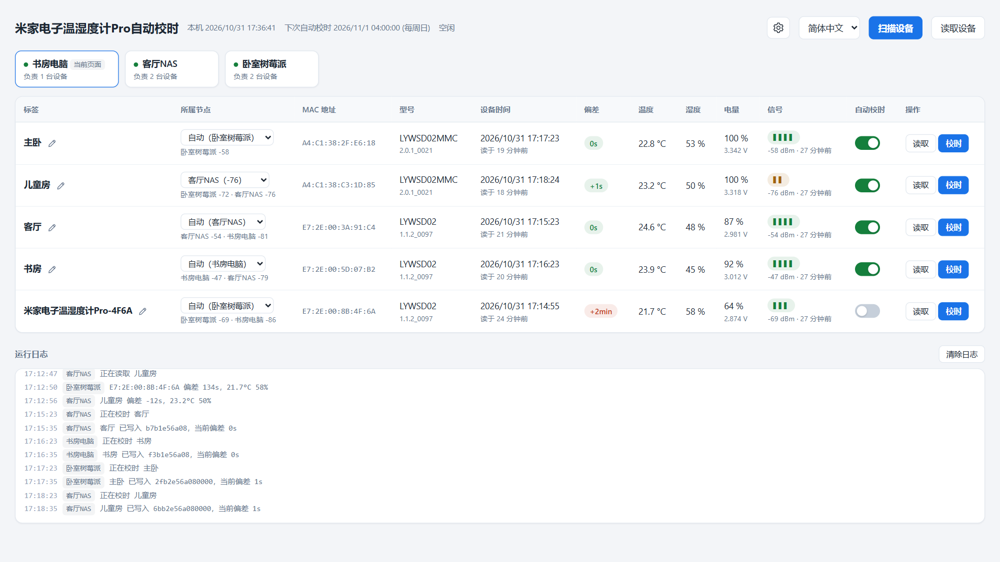
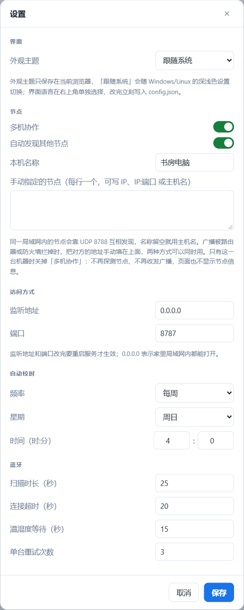

# 米家电子温湿度计Pro自动校时（LYWSD02 Clock Sync）

简体中文 | [繁體中文](README.zh-TW.md) | [English](README.md)

让电脑或 NAS 定期给小米米家墨水屏蓝牙温湿度计校时，不用再隔一两个月打开米家 App 手动对一次。

这款设备不联网，时间只能靠手机上的米家 App 写入，放着不管一两个月就会差出几分钟。本项目按计划通过低功耗蓝牙（BLE）连上设备，写入本机的时间。

- 网页上一台设备一行：标签、MAC、型号、设备时间、偏差、温度、湿度、电量、信号
- 每行有**读取**、**校时**按钮和单独的自动校时开关
- 定时自动校时（默认每周一次），关机错过了，开机后会补上
- 多台机器可以组成集群覆盖全屋，在任意一个页面上都能操作任意一台设备，由信号最好的机器去连
- Windows 是带图形界面的 `Setup.exe`，安装过程实时显示在窗口里；Linux 是原生 `.deb`，有 amd64 和 arm64 两种。程序自带运行环境，不用另装 Python 或运行库
- 校时频率、监听地址、蓝牙超时都能在网页的设置里改
- 界面有简体中文、繁體中文、English，右上角切换
- 深色/浅色主题，默认跟随系统
- 前端没有任何依赖，不用 npm，不走 CDN

<picture>
  <source media="(prefers-color-scheme: dark)" srcset="docs/images/main-zh-CN-dark.png">
  
</picture>

## 目录

- [支持的操作系统](#支持的操作系统)
- [支持的设备](#支持的设备)
- [如何确认你的设备在支持范围内](#如何确认你的设备在支持范围内)
- [安装](#安装)
  - [Windows](#windows)
  - [Debian / Ubuntu / fnOS](#debian--ubuntu--fnos)
  - [验证安装结果](#验证安装结果)
- [使用](#使用)
- [多台机器组成一个集群](#多台机器组成一个集群)
- [管理服务](#管理服务)
- [配置文件](#配置文件)
- [HTTP 接口](#http-接口)
- [工作原理](#工作原理)
- [协议细节](#协议细节)
- [安全性](#安全性)
- [故障排查](#故障排查)
- [卸载](#卸载)
- [从源码运行与打包](#从源码运行与打包)
- [许可证](#许可证)

## 支持的操作系统

蓝牙部分用的是 [bleak](https://github.com/hbldh/bleak)，平台要求和它一致。

| 平台 | 最低要求 | 说明 |
| --- | --- | --- |
| Windows | Windows 10 1709（build 16299），x64 | 推荐 Windows 11。ARM64 安装包为实验性。必须在交互式用户会话里运行，见下文。 |
| Linux | glibc 2.36+、BlueZ 5.43+，amd64 或 arm64 | Debian 12+、Ubuntu 23.04+、Raspberry Pi OS bookworm+、fnOS 等使用 systemd 的 Debian 系发行版。需要能访问 BlueZ 的 D-Bus。 |
| macOS | 10.13 | 没有安装包，只能[从源码运行](#从源码运行与打包)。理论上可用，未测试。 |

安装包已自带 Python 运行环境。只有从源码运行或自己打包才需要 Python 3.10+。

> **Windows：** WinRT 蓝牙 API 在 Session 0（Windows 服务所在的会话）里用不了，所以安装程序注册的是**登录时**启动的计划任务，跑在你的用户会话里。不要把它改成 Windows 服务。

> **Linux：** 服务要通过系统 D-Bus 和 BlueZ 通信。deb 里的 systemd 服务以 `root` 运行，在家用服务器上最省事。想用普通用户运行，把用户加进 `bluetooth` 组，再用 `sudo systemctl edit lywsd02-clock-sync` 加上 `User=`。不要直接改 `/usr/lib/systemd/system` 里的文件，升级时会被覆盖。

### 已测试的环境

| 平台 | 扫描 | 读取时间/传感器 | 写入时间 |
| --- | --- | --- | --- |
| Windows 11 专业版 25H2 (build 26200.9711) | 通过 | 通过 | 尚未确认 |
| fnOS 1.2.0800 x86_64（基于 Debian） | 尚未测试 | 尚未测试 | 尚未测试 |

欢迎补充其他平台的测试结果。提 issue 时请附上型号和固件版本（读取后显示在**型号**列）以及页面底部的运行日志。

## 支持的设备

| 型号 | 产品 ID | 硬件版本 | 已验证固件 | 时间数据长度 |
| --- | --- | --- | --- | --- |
| LYWSD02 | `0x045B` | `F2_LN` | `1.1.2_0097` | 5 字节 |
| LYWSD02MMC | `0x2542` | `F4_QT` | `2.0.1_0021` | 7 字节 |
| LYWSD02MMC | `0x16E4` | — | — | 靠产品 ID 识别，未实测 |

都是带时钟的方形墨水屏「米家蓝牙温湿度计」。两种数据长度会自动适配：写入前先读出当前值，时区字节后面的内容原样写回。

其他带 `ebe0ccb0` 服务的小米设备也许能用：把产品 ID 加到 [`lywsd02.py`](lywsd02.py) 的 `KNOWN_PRODUCT_IDS`，再[从源码运行或重新打包](#从源码运行与打包)，扫描就能识别。

**不支持：** LYWSDCGQ（圆形，没有时钟）、LYWSD03MMC（屏幕上没有时钟），以及米家本身也不能校时的设备。

## 如何确认你的设备在支持范围内

按顺序做下面三步，第 3 步说了算。三步都只读，不会写入设备。

**1. 在米家里看型号**

设备 → 设置（⚙）→ 设备信息，型号应为 `LYWSD02` 或 `LYWSD02MMC`。顺便记下这一页的 MAC 地址。

**2. 扫描**

[安装](#安装)后打开网页，点**扫描设备**。约 25 秒后表格里应出现一行，MAC 和米家里的一致。

满足以下任一条件就会被识别：设备名包含 `LYWSD02`；广播了 `ebe0ccb0` 服务；`fe95` 服务数据里的产品 ID 在上表中。实测的 LYWSD02MMC（`0x2542`）既不广播名字也不广播服务，只能靠产品 ID 识别。

一直扫不到的话，先看[故障排查](#故障排查)里的「扫描只能找到一部分设备」。还不行，就用手机上的 nRF Connect 等 BLE 工具找到这个 MAC，看它的 `fe95` 服务数据：第 3、4 字节按小端读就是产品 ID，比如 `30 58 42 25 …` 是 `0x2542`。

**3. 读取一次**

点这一行的**读取**。它会连上设备，读出时间、温度、湿度和电量并算出偏差，但不写入。只要**设备时间**有值、**型号**列显示了型号和固件版本，就说明时间特征 `ebe0ccb7` 存在且格式能识别，可以校时。它的格式是小端 uint32 的 Unix 时间戳加一个有符号的时区字节，见[协议细节](#协议细节)。

就算设备不接受写入，点**校时**也只会在日志里记一条失败，没有其他影响。

## 安装

到 [Releases](../../releases) 页面下载对应平台的安装包：

| 平台 | 文件 |
| --- | --- |
| Windows x64 | `LYWSD02ClockSync-Setup-<版本>-x64.exe` |
| Windows ARM64（实验性） | `LYWSD02ClockSync-Setup-<版本>-arm64.exe` |
| Debian / Ubuntu / fnOS，x86_64 | `lywsd02-clock-sync_<版本>_amd64.deb` |
| 64 位 ARM Linux：树莓派 4/5、ARM 版 NAS 等 | `lywsd02-clock-sync_<版本>_arm64.deb` |

32 位 ARM 没有安装包，可以[从源码运行](#从源码运行与打包)。

安装时只需要选端口（Windows 上还要选语言），其他设置都在网页里改。升级直接装新版本，设置和设备标签都会保留。

### Windows

1. 下载 `LYWSD02ClockSync-Setup-<版本>-x64.exe`，双击运行。
2. UAC 弹窗点「是」。注册计划任务和添加防火墙规则需要管理员权限。
3. 选择界面语言、安装位置和网页端口，点**安装**。窗口里会逐项显示安装进度，点**显示详细信息**可以看完整日志，装完点**打开网页**。

安装包没有代码签名，首次运行时 SmartScreen 可能提示「Windows 已保护你的电脑」，点**更多信息** → **仍要运行**即可。不放心的话可以[自己打包](#从源码运行与打包)。

窗口里有两个选项：

- **登录 Windows 时自动在后台运行**：每次登录时由计划任务启动。关掉也会注册任务，只是要从开始菜单打开程序，点**启动**才会运行。
- **允许局域网里的其它设备访问**：为程序添加一条入站防火墙规则，放通网页端口和节点发现用的 UDP 8788。只在本机用可以关掉。

安装程序依次执行：

1. 停止正在运行的服务。如果端口上响应的不是本服务，安装会在这一步停下并提示；
2. 把程序解压到安装位置，默认是 `%LocalAppData%\Programs\LYWSD02ClockSync`；
3. 把端口和语言写进数据目录的 `config.json`，其他设置不变；
4. 创建开始菜单快捷方式，登记到「设置 → 应用 → 已安装的应用」；
5. 添加防火墙规则 `LYWSD02 Clock Sync`；
6. 注册并启动计划任务 `LYWSD02ClockSync`，最多等 30 秒，确认网页端口有响应。

程序和数据分开存放：设置、设备标签和 `server.log` 在 `%LocalAppData%\LYWSD02ClockSync`，升级不会动它，卸载时默认也保留。装在用户目录而不是 Program Files，是因为登录任务以普通权限运行，写不了 Program Files。

计划任务必须属于**交互式**用户。WinRT 蓝牙在 Session 0 里不工作，所以不要以 `SYSTEM` 身份安装，也不要把任务改成服务。同理，如果在 UAC 弹窗里输入的是另一个管理员账号的密码，安装程序会拒绝继续，否则任务和数据都会装到那个账号下。请登录实际使用的账号，在这个账号里确认 UAC。

**静默安装**适合批量部署。安装包始终需要管理员权限，请在已提权的终端里运行，或在弹出的 UAC 里确认：

```powershell
.\LYWSD02ClockSync-Setup-1.0.0-x64.exe --silent --port 8787 --language zh-CN
```

| 参数 | 含义 |
| --- | --- |
| `--silent` | 不显示窗口，按参数直接安装 |
| `--dir <目录>` | 安装位置 |
| `--port <端口>` | 网页端口 |
| `--language <代码>` | 界面语言：`zh-CN`、`zh-TW` 或 `en` |
| `--no-autostart` | 不在登录时自动运行 |
| `--no-firewall` | 不加防火墙规则 |

没指定的位置、端口和语言沿用已有安装的值，全新安装则用默认值；之前关掉了自动运行的，升级后仍然是关的。这些参数在窗口模式下也有效，用来预填表单。退出码 `0` 表示安装成功且服务有响应，过程记录在 `%TEMP%\LYWSD02ClockSync-setup.log`。

### Debian / Ubuntu / fnOS

```bash
sudo apt install ./lywsd02-clock-sync_1.0.0_amd64.deb
```

没装 `bluez` 的话 `apt` 会一并装上。`dpkg -i` 也能装，但不会装推荐的依赖。

装好后服务 `lywsd02-clock-sync.service` 已经启动并设为开机自启，网页地址是 `http://<这台机器>:8787`。

| 路径 | 内容 |
| --- | --- |
| `/opt/lywsd02-clock-sync/` | 程序本体 |
| `/usr/lib/systemd/system/lywsd02-clock-sync.service` | systemd 服务 |
| `/var/lib/lywsd02-clock-sync/` | 设置、设备标签和调度记录，由 systemd 的 `StateDirectory=` 管理 |

服务的输出写入 journal，所以 Linux 上没有 `server.log`。

如果 `ufw` 或 `firewalld` 已启用，安装时会放通网页端口（TCP）和节点发现用的 UDP 8788，卸载时删除；都没启用就不做改动。其他防火墙，包括 NAS 系统自带的图形界面防火墙，需要你自己放通这两个端口。放通的是安装时 `config.json` 里的端口，之后改了端口，防火墙规则也要自己改。

升级：用 `sudo apt install` 安装新版本的 deb，服务会自动重启，`/var/lib` 里的数据不受影响。

fnOS 上先在系统设置里开启 SSH，用管理员账号登录后执行上面的命令。fnOS 的文件管理器通常看不到 `/opt` 和 `/var/lib`，这是正常的。

### 验证安装结果

Windows：从开始菜单打开「米家电子温湿度计Pro自动校时」，窗口里应显示「运行中」和网页地址。也可以用命令检查：

```powershell
schtasks /Query /TN LYWSD02ClockSync
Invoke-WebRequest http://127.0.0.1:8787/api/state | Select-Object -Expand Content
```

Linux：

```bash
systemctl status lywsd02-clock-sync
journalctl -u lywsd02-clock-sync -n 50
curl -s http://127.0.0.1:8787/api/state
```

## 使用

浏览器打开 `http://<地址>:8787`。

1. 点**扫描设备**，约 25 秒后附近的设备会出现在表格里。还没起名的设备显示为 `米家电子温湿度计Pro-<MAC 后 4 位>`，随界面语言变化。
2. 点铅笔图标起个名字。标签按 MAC 保存，重启和重新扫描都不会丢。
3. 点**校时**立即写入时间，**偏差**列应变成绿色的 `+0s` 或 `-1s`。
4. 要参与定时校时的设备，保持**自动校时**开关打开。

顶部显示本机时间和下次自动校时的时间。底部日志显示所有节点最近 150 条事件，每条都标明来自哪个节点。

有多台机器时，表格上方会列出所有节点和各自负责的设备数，**所属节点**列显示每台设备归哪个节点负责，见[多台机器组成一个集群](#多台机器组成一个集群)。

语言下拉框左边的 ⚙ 打开设置：外观主题、监听地址和端口、自动校时频率、蓝牙超时都在这里。保存后写入 `config.json`，改了地址或端口要重启服务，其余立即生效。外观主题例外，它只保存在浏览器里，选「跟随系统」会跟着 Windows 或 Linux 的深浅色设置变。

<picture>
  <source media="(prefers-color-scheme: dark)" srcset="docs/images/settings-zh-CN-dark.png">
  
</picture>

右上角的下拉框切换简体中文、繁體中文和 English。它单独放在外面，是因为看不懂界面时，第一件事就是改语言。选择后立即写入 `config.json` 的 `language`，之后用任何浏览器打开都是这个语言，Windows 的安装和管理窗口也会用它。日志在浏览器端翻译，切换语言后已有的日志也会一起换。

扫描和连接是串行的，因为蓝牙适配器不能同时做这两件事。请求会排队，顶部显示当前在做什么。

传感器数据只在点**读取**或**校时**时刷新，没有后台轮询，因为每次连接都在消耗纽扣电池。**扫描设备**旁边的**读取设备**一次读取全部设备：各节点同时读取自己负责的设备，全部读完才释放锁。它只读不写，也不受自动校时开关影响。

## 多台机器组成一个集群

一个蓝牙适配器的覆盖范围有限。在设备附近的每台机器上都装一份，比如卧室的台式机和客厅的家庭服务器，它们会在局域网里互相发现，作为一个整体工作。没有主节点，也没有共享数据库：每个节点维护自己的 `devices.json`，页面上显示的是所有节点已知设备的合集。

每个节点只操作本机的蓝牙适配器。在页面上对另一个节点负责的设备点**校时**，请求会转发给那个节点执行。转发过去的请求不会再次转发，所以最多只有一跳。

### 节点名字与发现方式

在设置里给每台机器起个名字，比如「卧室」「客厅」。留空则用主机名；保存时如果框里还是主机名，存下的仍是空值，以后机器改名，节点名会跟着变。这个名字保存在 `config.json`，显示在设备表格和日志里。节点的身份是 `state.json` 里的随机 id，所以把配置文件复制到别的机器上，也不会让两个节点被当成同一个。

两种发现方式同时工作，任意一种通了就行：

| 方式 | 端口 | 什么时候有效 |
| --- | --- | --- |
| UDP 广播 | 8788 | 同一子网且允许广播时有效，无需配置。150 秒没有消息的节点会被移除。 |
| 手动指定 | 网页端口 | 始终有效。在设置的*手动指定的节点*里填 `192.168.1.20`、`192.168.1.20:8787` 或 `nas`。 |

广播被挡住时（访客 VLAN、AP 隔离、防火墙只放通了 TCP 端口）就用手动指定。两种方式都发现了同一个节点，也只算一个。

有页面打开时每 10 秒广播一次，没人看时 60 秒一次。收到陌生地址的广播会立即回应一次，所以即使双方都处在慢速档，新节点也不用等一分钟才出现。

节点探测对方时会带上自己的网页端口，对方收到后会把它加进自己的列表。所以只要在一台机器上手动填了地址，两边就能互相看到；广播只能单向发出时（比如 NAS 只从一块网卡往外发）也能连通。8788 端口被占用时只记一条日志，在后台重试，手动指定的节点不受影响。

想在一台机器上试集群，可以[从源码](#从源码运行与打包)启动多份服务：每份用 `LYWSD02_DATA_DIR` 指向不同的数据目录，目录里放一个只写了不同 `port` 的 `config.json`，再把其他几份的 `127.0.0.1:<端口>` 填进手动指定的节点。它们会像几台独立的机器一样组成集群，只是只有第一个能占到广播端口，而且共用同一个蓝牙适配器。安装包做不到：服务名是固定的，一台机器只能装一份。

### 哪个节点负责哪台设备

每个节点都会上报自己收到每台设备的信号强度，信号最强的节点负责这台设备。比较前信号按 6 dBm 取整，这样各节点不用商量就能得出相同的结果，邻居也必须明显更近才能抢走归属，差一两个 dBm 不会来回跳。**所属节点**列显示负责的节点，下面是各节点的信号值。每次扫描会整体替换该节点的数据，扫不到的设备会从它的列表里去掉，不会一直挂着旧信号。

自动分配不合适的话，直接在这一列里选一个节点，设备就固定由它负责。固定后不会因为别处信号更强而改变，也不会被接管。下拉框里只有最近一次扫描收到这台设备的节点，选别的肯定连不上；设备挪了位置，先重新扫描再改。固定的节点后来收不到这台设备时，会标为「扫不到」并保留，直到你改掉。

定时校时按归属分工：到了计划时间，每个节点只校自己负责的设备，三个节点不会在 04:00 把同一台时钟校三遍。

### 同时只允许一个操作

一台时钟只该由一台机器写入，多个适配器同时工作，日志也会乱成一团，所以任何操作都会锁住整个集群。发起操作的节点先向所有能联系上的节点申请锁，全部同意后才开始。期间其他操作，比如别的页面上的按钮、别的节点的定时任务，都会被拒绝，并提示是哪个节点在忙；结束之前所有页面的按钮都是灰的。

联系不上的节点不参与投票。关着的机器不可能在用蓝牙，如果让它有否决权，一台休眠的电脑就能卡住整个集群。持锁节点中途掉线时，锁会在 30 秒后释放；任务卡死也最多占用 15 分钟。

### 某个节点离线时

节点掉线后仍负责原来的设备，因为它在物理上还是离这些设备最近的，改派给几乎收不到信号的适配器只会更糟。这些行会显示离线标记，**读取**和**校时**按钮不可用。

标签、自动校时开关和指定的节点例外：它们在任何页面上都能改，靠时间戳同步到其他节点，所以节点离线时照样能改，等它回来后以最后一次修改为准。

负责节点离线超过 26 小时的设备，会由其他能收到它的节点接管，一台整个周末都关着的电脑不会让时钟一直没人校。指定了节点的设备不会被接管。

### 用不到的时候关掉

只有一台机器时，集群功能用不上。设置里有两个开关，对应 `config.json` 的两个键：

| 开关 | 键 | 关掉之后 |
| --- | --- | --- |
| 多机协作 | `node.cluster` | 不再探测节点、不收发广播、不接受节点间请求（`/api/node/*` 一律返回 503），页面也不显示节点栏和**所属节点**列 |
| 自动发现其他节点 | `node.discovery` | 集群照常工作，只是不收发 UDP 广播、释放 8788 端口，节点只来自手动指定的列表 |

定时校时也可以关：把计划设为**关闭**，调度器就不会动蓝牙。

其余省电措施都是自动的：

- 节点探测分三档：有页面打开时 2 秒一次，有节点但没人看时 60 秒一次，从没有节点响应过时 300 秒一次。闲置时对每个节点每天的探测次数从 43200 降到 1440。
- 页面切到后台就停止轮询，切回来立即刷新一次，忘记关的标签页不会一直唤醒那台机器。
- 连续 30 秒以上联系不上的节点，最多每分钟探测一次，不会每次刷新都去试，关着的机器不会拖慢页面：有一个节点掉线时，首个请求从 1.5 秒降到几毫秒。一旦收到它的广播或探测，马上恢复正常。
- 页面只重绘有变化的部分，一次空闲刷新的浏览器开销从约 22 毫秒降到约 1 毫秒。
- 探测频率低只影响表格是否及时，不影响正确性：每次操作、每次申请锁之前都会先强制探测一轮，不会按过期的节点列表行事。
- 到了计划时间，节点先根据已知信息判断有没有自己要校的设备，没有就跳过，不申请锁也不扫描。唯一的例外是本机蓝牙还从没收到过列表里的任何设备，这时只有扫描才知道附近有没有，所以照常扫描。

## 管理服务

**Windows：** 从开始菜单打开「米家电子温湿度计Pro自动校时」就是管理窗口，每两秒刷新一次服务状态：

| 按钮 | 作用 |
| --- | --- |
| 打开网页 | 用默认浏览器打开网页 |
| 启动 / 停止 | 启动或停止计划任务，并等到端口开始响应或已经释放 |
| 打开数据目录 | 打开 `%LocalAppData%\LYWSD02ClockSync` |
| 卸载 | 打开卸载窗口，见[卸载](#卸载) |

点**启动**后 25 秒内端口没有响应会报失败，原因看数据目录里的 `server.log`：服务没有控制台，启动时的报错都写在这个文件里。

也可以直接操作计划任务：

```powershell
schtasks /Run /TN LYWSD02ClockSync      # 启动
schtasks /End /TN LYWSD02ClockSync      # 停止
```

**Linux：**

```bash
sudo systemctl start lywsd02-clock-sync
sudo systemctl stop lywsd02-clock-sync
sudo systemctl restart lywsd02-clock-sync    # 改了监听地址或端口之后
sudo systemctl disable lywsd02-clock-sync    # 不再开机自启
journalctl -u lywsd02-clock-sync -f          # 实时看日志
```

## 配置文件

### `config.json`

所有配置项都在这里。它和下面的 `state.json`、`devices.json` 都放在数据目录，不在程序目录：

| 平台 | 数据目录 |
| --- | --- |
| Windows | `%LocalAppData%\LYWSD02ClockSync` |
| Linux | `/var/lib/lywsd02-clock-sync` |
| 从源码运行 | 源码目录本身 |

设置了环境变量 `LYWSD02_DATA_DIR` 时以它为准。

文件不存在或缺少某些键时都用默认值，所以只写要改的几项就行。网页的设置也是写这个文件，手工编辑前请先停止服务，否则下次在网页上保存会覆盖你的修改。`host` 和 `port` 重启服务后生效，其余立即生效。

| 键 | 默认值 | 含义 |
| --- | --- | --- |
| `language` | `"zh-CN"` | 网页及 Windows 安装、管理窗口的语言，右上角下拉框也会写入：`zh-CN`、`zh-TW`、`en` |
| `host` | `"0.0.0.0"` | 监听地址 |
| `port` | `8787` | 监听端口 |
| `node.name` | `""` | 本节点在表格和日志里的名字，留空表示用主机名 |
| `node.peers` | `[]` | 手动指定的节点，例如 `["192.168.1.20", "nas:8787"]` |
| `node.cluster` | `true` | 关闭即单机模式：不探测节点、不收发广播、不接受节点间请求 |
| `node.discovery` | `true` | 关闭后只停用 UDP 广播，手动指定的节点照常使用 |
| `schedule.mode` | `"weekly"` | `weekly`、`daily` 或 `off` |
| `schedule.weekday` | `6` | `0` = 周一 … `6` = 周日 |
| `schedule.hour` | `4` | 本地时间的小时 |
| `schedule.minute` | `0` | 本地时间的分钟 |
| `bluetooth.scan_timeout` | `25.0` | 每次扫描的秒数 |
| `bluetooth.connect_timeout` | `20.0` | 连接等待秒数 |
| `bluetooth.env_timeout` | `15.0` | 等待传感器通知的秒数 |
| `bluetooth.retries` | `3` | 每台设备的连接尝试次数 |

### `state.json`

调度器的记录，由服务写入：`last_auto_run` 是上次自动校时的 Unix 时间戳，`node_id` 是本节点的随机身份，`nodes` 是见过的节点 id 和名字。删掉它等于清空这些记录，不要手工编辑。单独放一个文件，是为了不让调度记录碰到你的设置，把 `config.json` 复制到另一台机器时也不会连节点身份一起复制过去。

### `devices.json`

由服务创建和维护。键是去掉分隔符的 MAC 地址，`label` 和 `auto` 由你设置，其余是最近一次读取的缓存。

```json
{
  "A4C13877596D": {
    "address": "A4:C1:38:77:59:6D",
    "label": "走廊",
    "auto": true,
    "rssi": -67,
    "last": {
      "model": "LYWSD02MMC",
      "firmware": "2.0.1_0021",
      "temperature": 24.13,
      "humidity": 60,
      "drift": -1
    }
  }
}
```

三个文件都是原子写入（先写临时文件再 `os.replace`），断电也不会留下写了一半的文件。

从源码运行时它们就在源码目录里，所以都加进了 `.gitignore`。`devices.json` 里有你的设备 MAC 地址，不要提交。

## HTTP 接口

| 方法 | 路径 | 作用 |
| --- | --- | --- |
| `GET` | `/api/state` | 页面需要的全部数据：设备、节点、锁、队列、计划、日志、界面语言 |
| `GET` | `/api/ping` | 只表示服务在运行；和 `/api/state` 不同，它不算「有人在看」 |
| `POST` | `/api/scan` | 排队扫描，本机和所有能联系上的节点都扫 |
| `POST` | `/api/read` | 所有能联系上的节点读取各自负责的设备 |
| `POST` | `/api/devices/{key}/refresh` | 排队读取时间和传感器 |
| `POST` | `/api/devices/{key}/sync` | 排队写入时间 |
| `PATCH` | `/api/devices/{key}` | `{"label": "...", "auto": true, "owner_pin": "<节点 id>"}` |
| `POST` | `/api/logs/clear` | 清空内存中的运行日志 |
| `GET` | `/api/settings` | 设置里能改的配置项 |
| `PUT` | `/api/settings` | 整体保存，返回 `{"restart_required": bool}` |
| `PUT` | `/api/language` | 语言下拉框使用：`{"language": "zh-CN"}` |

`{key}` 是去掉分隔符的 MAC 地址。排队类的 `POST` 立即返回 `{"queued": true}`，结果从 `/api/state` 查看。属于其他节点的设备会转到那个节点执行，调用方无需关心。

节点之间用另一组更窄的接口，只操作本节点的蓝牙、不再转发，所以请求最多一跳。这些接口是给节点之间用的，都是普通 JSON：

| 方法 | 路径 | 作用 |
| --- | --- | --- |
| `GET` | `/api/node/state` | 本节点自己掌握的信息 |
| `POST` | `/api/node/lock` | 申请集群锁，本节点正忙时拒绝 |
| `POST` | `/api/node/unlock` | 释放集群锁 |
| `POST` | `/api/node/scan` | 用本节点的蓝牙扫描，需要持锁者的令牌 |
| `POST` | `/api/node/read` | 读取本节点负责的设备，需要持锁者的令牌 |
| `POST` | `/api/node/devices/{key}/refresh` | 用本节点的蓝牙读取 |
| `POST` | `/api/node/devices/{key}/sync` | 用本节点的蓝牙写入 |
| `POST` | `/api/node/logs/clear` | 清空本节点的日志 |

拒绝时返回的是文案键而不是现成的句子，每个页面用自己的语言显示：`{"detail": {"event": "error.clusterBusy", "params": {...}}}`。关闭了多机协作的节点对这组接口一律返回 503 `error.clusterOff`，对方页面会显示相应的提示，不会只显示「连不上」。

```bash
curl -s http://127.0.0.1:8787/api/state | python -m json.tool
curl -X POST http://127.0.0.1:8787/api/devices/A4C13877596D/sync
curl -X PATCH http://127.0.0.1:8787/api/devices/A4C13877596D \
  -H 'Content-Type: application/json' -d '{"label":"走廊","auto":true}'
```

## 工作原理

```
app.py           程序入口：serve 启动服务，Windows 上不带参数打开管理窗口
paths.py         程序资源和数据目录的位置
lywsd02.py       BLE 协议：扫描、产品 ID 匹配、时间编解码、
                 自适应长度写入、传感器与身份信息读取
store.py         JSON 原子写入
cluster.py       节点身份、节点发现、集群锁、归属合并
server.py        FastAPI 应用、串行任务队列、调度器、REST 接口
static/          单页前端，原生 JS，不请求任何外部资源
  index.html     结构、样式与渲染
  i18n.js        zh-CN / zh-TW / en 文案
  icon.png       网页图标
winsetup.py      Windows 的安装、管理和卸载窗口（tkinter）
packaging/
  build.py       在当前平台打出 Setup.exe 或 .deb
  installer.py   Setup.exe 的入口
  linux/         systemd 服务和 deb 的维护脚本
  icon.ico       程序图标
VERSION          版本号，打包和发布都从这里读
```

后端不拼接给人看的句子。日志以「事件名 + 参数」的形式发出（`{"event": "device.synced", "params": {...}}`），由浏览器转成文字，所以切换语言立即生效，文案也只需维护一份。

蓝牙适配器不能同时扫描和连接，所以 `server.py` 把所有操作放进一个单消费者的 `asyncio.Queue`。同一台设备已经在队列里时，重复的请求会被丢弃。

调度器每分钟检查一次，算出计划最近一次应该触发的时间。如果 `state.json` 里的 `last_auto_run` 早于这个时间就立即执行，所以周日 04:00 关着机的机器开机后会马上补跑，不用再等一周，效果和 systemd timer 的 `Persistent=true` 一样。

服务首次启动时把 `last_auto_run` 设为当前时间，所以全新安装不会把上一个计划时间当成错过的那次立即补跑，第一次自动校时就在下一个计划时间。

`cluster.py` 没有引入额外依赖：节点之间的调用是工作线程里的 `urllib.request`，节点发现用 UDP 广播而不用 mDNS，免得在连 PyPI 都费劲的机器上再多装一个包。设备数据按字段「后写入为准」合并，两个节点同时改同一个标签时，结果以较晚的修改为准，不需要事务。

只有 `/api/state` 的请求算「有人在看」，节点之间的探测不算，否则两台闲置的机器互相探测，会让彼此一直处在最快的那一档。两个后台循环各用各的唤醒事件，如果共用一个，先醒的会把另一个的通知吃掉。

## 协议细节

以下内容都在实机上验证过。米家时钟服务是 `ebe0ccb0-7a0a-4b0c-8a1a-6ff2997da3a6`。

### 时间：`ebe0ccb7`

| 字节 | 类型 | 含义 |
| --- | --- | --- |
| 0–3 | uint32 小端 | Unix 时间戳，UTC |
| 4 | int8 | 时区偏移，整小时（UTC+8 就是 `0x08`） |
| 5+ | — | LYWSD02MMC 上才有（`0x0000`），读出后原样写回 |

时区字段只能表示整小时，UTC+5:30 这类偏移要把多出来的部分折进时间戳：

```python
offset = time.localtime(now).tm_gmtoff
struct.pack("<Ib", int(now) + offset % 3600, offset // 3600)
```

LYWSD02MMC 的 `ebe0ccb7` 属性是 `[write,read]`，不支持 write-without-response，所以必须用 ATT Write Request（opcode `0x12`，即 bleak 的 `response=True`），不能用 Write Command（`0x52`）。

### 传感器：`ebe0ccc1`

| 字节 | 类型 | 含义 |
| --- | --- | --- |
| 0–1 | int16 小端 | 温度 × 100，°C |
| 2 | uint8 | 相对湿度，% |
| 3–4 | uint16 小端 | 电池电压 × 1000，V |

LYWSD02MMC 可以直接读；LYWSD02 读出来是空的，只通过通知上报，所以代码先读，读到空数据再改为订阅通知。

### 其他特征

| UUID | 含义 |
| --- | --- |
| `ebe0ccc4` | 电量百分比（uint8） |
| `2a24` | 型号，例如 `LYWSD02MMC` |
| `2a25` | 序列号，唯一且不变 |
| `2a26` | 固件版本 |
| `2a27` | 硬件版本，例如 `F4_QT` |
| `2a23` | System ID，前 6 字节倒过来就是 MAC |

### 设备标识

`2a00`（Device Name）是只读的，不能通过 BLE 改名。米家里的 `设备 ID`（`blt.3.…`）由小米云端分配，设备上读不到；CMIIT ID 对应的是型号，不是某一台设备。设备上唯一稳定的标识是 MAC 地址和序列号，所以本项目用 MAC 作为标签的键。

### 不要盲目写入

`ebe0ccd2` 里存的疑似配对/绑定码。往不清楚用途的特征里写数据，可能要在米家里重新配网。本项目只写 `ebe0ccb7` 这一个特征，**读取**按钮什么都不写。

## 安全性

本服务**没有任何身份验证**，能访问这个端口的人都能改标签、改设备时间。

- `0.0.0.0` 只适合可信的家庭局域网。
- 其他情况请在设置里把监听地址改成 `127.0.0.1`（Windows 安装时也关掉防火墙选项），再通过 SSH 隧道访问。
- 不要把这个端口暴露到公网，也不要做端口映射。
- 节点之间同样没有验证，只因为在同一个网络里才互相信任，集群的安全性取决于你的网络。绑定 `127.0.0.1` 相当于关掉集群，因为联系不到别的节点。

小米 `fe95` 加密广播（bindkey 机制）只影响**被动**解析广播数据。本项目用的是主动 GATT 读写，不需要 bindkey。

## 故障排查

**双击 Setup.exe 后没反应**

多半是在 UAC 弹窗里点了「否」，再双击一次即可。如果 SmartScreen 提示「Windows 已保护你的电脑」，点**更多信息** → **仍要运行**。安装包没有代码签名，下载量还少的新版本都会这样。

**安装停在第一步，提示端口上有其他程序在响应**

端口被别的程序占着，多半是从源码手动启动的服务。关掉它，或者换个端口再装。

**安装程序提示正以另一个账号运行**

UAC 弹窗里输入的是另一个管理员账号。计划任务和数据必须属于实际使用的账号，请登录那个账号，在它的会话里确认 UAC。

**本机能打开页面，其他机器打不开**

在设置里确认监听地址是 `0.0.0.0` 而不是 `127.0.0.1`，再检查防火墙规则：Windows 用 `netsh advfirewall firewall show rule name="LYWSD02 Clock Sync"`，没有就重新运行一次 Setup 并打开防火墙选项；Linux 用 `ufw status` 或 `firewall-cmd --list-ports`，NAS 自带的防火墙要到它的管理界面里看。

**另一个节点一直不出现在节点栏里**

先在浏览器里打开 `http://<另一台机器>:8787/api/node/state`。打不开就是网络不通，和发现机制无关。返回 503 `error.clusterOff` 说明那台机器关了**多机协作**，去它的设置里打开。能打开但节点还是不出现，就是 UDP 广播被挡了，比如 AP 隔离、访客 VLAN，或防火墙只放通了 TCP 端口。把那台机器的地址填进设置的*手动指定的节点*，这条路走网页端口，不依赖广播。

**扫描只能找到一部分设备**

米家 App 在前台或刚切到后台时会占着连接。把附近所有手机上的米家都强行停止，在设置里把「扫描时长」调到 40 秒再扫一次。设备正被别的连接占着时不会响应扫描。

**连接时报 `BleakDeviceNotFoundError`**

设备要先被扫描到才能连接。服务每次连接前都会重新查找一次地址，找不到才直接用地址尝试。Linux 上如果看到的是 `BleakError("device 'dev_A4_C1_38_..' not found")`，是 BlueZ 已经把这台未配对的设备从 D-Bus 里移除了（停止扫描约半分钟后就会移除），重新查找即可，不用重启服务。

**Linux 上完全扫不到设备**

```bash
bluetoothctl list                 # 有蓝牙控制器吗？
systemctl status bluetooth        # BlueZ 在运行吗？
rfkill list bluetooth             # 是否被软屏蔽？
```

服务以非 root 用户运行时需要 BlueZ 的 D-Bus 权限：把用户加进 `bluetooth` 组，或者用 root 运行。

**Windows 重启后服务没有运行**

计划任务在**登录时**触发，不是开机时；安装时关掉了「登录 Windows 时自动在后台运行」的话，它不会自己启动。用 `schtasks /Query /TN LYWSD02ClockSync /V /FO LIST` 检查。不登录就运行是行不通的，WinRT 蓝牙在 Session 0 里基本用不了。

**装好了，但浏览器提示「拒绝了我们的连接请求」**

服务注册了，但没有在监听。Windows 上先在管理窗口里点**启动**，还不行就查：

```powershell
Get-ScheduledTask LYWSD02ClockSync | Get-ScheduledTaskInfo           # 运行过吗？返回值是多少？
Get-Content "$env:LOCALAPPDATA\LYWSD02ClockSync\server.log" -Tail 40   # 为什么退出了？
```

Linux 上看 `journalctl -u lywsd02-clock-sync -n 50`。

**偏差校正后很快又出现**

先检查本机的时间，设备最多只能和写入它的机器一样准。确认已启用 NTP（Windows 用 `w32tm /query /status`，Linux 用 `timedatectl`）。

**校时后偏差仍然很大**

写入成功但读回来还是不对，可能是数据长度和预期不符。请把型号、固件版本和运行日志贴到 issue 里。

**温湿度一直是空的**

LYWSD02 读 `ebe0ccc1` 返回的是空数据，只会按自己的节奏发通知。如果日志里一直出现`温湿度读取失败`，在设置里把「温湿度等待」调大一些。读不到温湿度不影响校时。

**墨水屏显示有延迟**

墨水屏按自己的节奏刷新，以 BLE 读回的值为准，屏幕一般一分钟内会跟上。

## 卸载

**Windows：** 在「设置 → 应用 → 已安装的应用」里找到它卸载，或者在管理窗口里点**卸载**。卸载会停止服务，删除计划任务、防火墙规则、开始菜单快捷方式和卸载登记，最后删除程序文件。因为程序自己正在运行，最后这一步要等窗口关闭后才完成。

打开「同时删除设置和设备数据」会把 `%LocalAppData%\LYWSD02ClockSync` 一起删掉；关着则保留，重新安装后接着用。你自己放进程序目录的文件不会被删，这种情况下目录也会保留。

静默卸载同样需要管理员权限，没有的话会弹出 UAC：

```powershell
& "$env:LOCALAPPDATA\Programs\LYWSD02ClockSync\LYWSD02ClockSync.exe" uninstall --silent           # 保留数据
& "$env:LOCALAPPDATA\Programs\LYWSD02ClockSync\LYWSD02ClockSync.exe" uninstall --silent --purge   # 连数据一起删
```

过程记录在 `%TEMP%\LYWSD02ClockSync-uninstall.log`。

**Linux：**

```bash
sudo apt remove lywsd02-clock-sync    # 保留 /var/lib/lywsd02-clock-sync
sudo apt purge lywsd02-clock-sync     # 连数据一起删
```

两种方式都会停止并禁用服务，删除安装时添加的 `ufw` / `firewalld` 规则。

本项目不写系统级注册表，除了时间之外不会改动设备上的任何东西。

## 从源码运行与打包

### 从源码运行

需要 Python 3.10+。Linux 上还需要 BlueZ，并且运行的用户要能访问它（root 或 `bluetooth` 组）。

```bash
python -m venv .venv
.venv/bin/pip install -r requirements.txt      # Windows：.venv\Scripts\pip
.venv/bin/python app.py serve                  # Windows：.venv\Scripts\python
```

数据文件放在源码目录，可以用环境变量 `LYWSD02_DATA_DIR` 换个位置。Windows 上 `python app.py` 不带参数打开的是管理窗口，它管理的是已安装的那一份，不是源码这一份。

### 打包

```bash
python packaging/build.py
```

脚本会创建独立的虚拟环境 `build/venv`，在里面装好依赖和 PyInstaller 再打包，本机的其他 Python 包不会混进安装包。产物在 `dist/`：

| 平台 | 产物 |
| --- | --- |
| Windows | `LYWSD02ClockSync-Setup-<版本>-<x64\|arm64>.exe`，约 34 MB |
| Linux | `lywsd02-clock-sync_<版本>_<amd64\|arm64>.deb` |

PyInstaller 不支持交叉编译，每种架构都要在对应架构的机器上打包。

**Windows** 需要 python.org 的 Python 3.10+（推荐 3.13），安装 Python 时保留默认勾选的 tcl/tk，安装和管理窗口用的是 tkinter。

**Linux** 的 deb 依赖打包机的 glibc 版本，所以要在**最老的目标系统**上打包。在 Debian 12（glibc 2.36）上打的包可以装在 Debian 12+、Ubuntu 23.04+、树莓派 OS bookworm 和 fnOS 上：

```bash
sudo apt install python3 python3-venv python3-dev binutils
python3 packaging/build.py
```

手边没有 Debian 12 的话可以用 Docker。arm64 的包要在 arm64 机器上运行这条命令：

```bash
docker run --rm -v "$PWD":/src -w /src debian:12 sh -c \
  "apt-get update && apt-get install -y python3 python3-venv python3-dev binutils && python3 packaging/build.py"
```

| 环境变量 | 作用 |
| --- | --- |
| `PIP_INDEX_URL` | pip 镜像，例如 `https://pypi.tuna.tsinghua.edu.cn/simple` |
| `DEB_MAINTAINER` | deb 的 `Maintainer` 字段，例如 `Name <you@example.com>` |
| `DEB_HOMEPAGE` | deb 的 `Homepage` 字段 |

## 致谢

蓝牙部分基于 [bleak](https://github.com/hbldh/bleak)。`ebe0ccb7` 的时间格式早已由小米 BLE 逆向社区记录，本项目在 LYWSD02 和 LYWSD02MMC 实机上做了验证，并补上了 7 字节的版本。

本项目为非官方项目，与小米公司无关。

## 许可证

[MIT](LICENSE)
