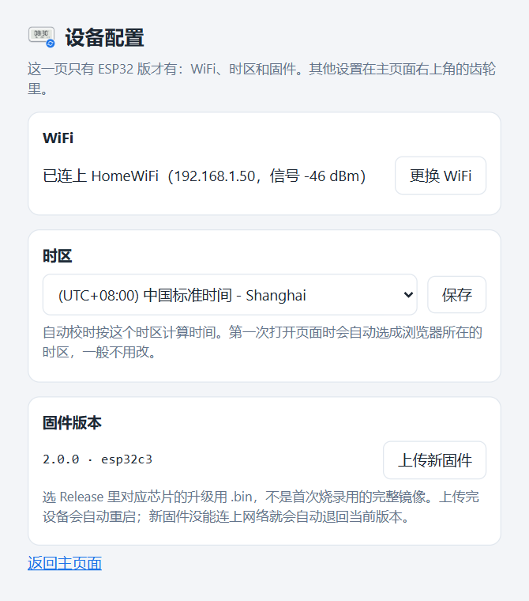

# 米家电子温湿度计Pro自动校时（LYWSD02 Clock Sync）

简体中文 | [繁體中文](README.zh-TW.md) | [English](README.md)

米家墨水屏蓝牙温湿度计不联网，时间只能靠米家 App 写入，放一两个月就会差出几分钟。本项目通过低功耗蓝牙（BLE）定期给它校时，可以装在电脑、NAS 上，也可以烧进一块 ESP32-C3 开发板。

- 网页上一台设备一行：设备时间、偏差、温度、湿度、电量、信号，每行都能单独读取、校时
- 定时自动校时，默认每周一次，关机错过的会在开机后补上
- 校时用的时间可以取本机时钟，也可以取指定的 NTP 服务器
- 支持 Windows、Linux（包括 fnOS 等 NAS）和 ESP32-C3，安装包自带运行环境
- 多台机器自动组成集群，每台设备由信号最好的那台去连，任意一个页面都能操作全部设备
- 简体中文、繁體中文、English，深色/浅色主题

<picture>
  <source media="(prefers-color-scheme: dark)" srcset="docs/images/main-zh-CN-dark.png">
  
</picture>

## 目录

- [支持的设备](#支持的设备)
- [运行环境](#运行环境)
- [安装](#安装)
- [使用](#使用)
- [多台机器组成集群](#多台机器组成集群)
- [管理服务](#管理服务)
- [配置文件](#配置文件)
- [HTTP 接口](#http-接口)
- [协议](#协议)
- [安全性](#安全性)
- [常见问题](#常见问题)
- [卸载](#卸载)
- [从源码运行](#从源码运行)

## 支持的设备

| 型号 | 产品 ID | 硬件版本 | 已验证固件 | 时间数据长度 |
| --- | --- | --- | --- | --- |
| LYWSD02 | `0x045B` | `F2_LN` | `1.1.2_0097` | 5 字节 |
| LYWSD02MMC | `0x2542` | `F4_QT` | `2.0.1_0021` | 7 字节 |
| LYWSD02MMC | `0x16E4` | — | — | 靠产品 ID 识别，未实测 |

都是带时钟的方形墨水屏「米家蓝牙温湿度计」。两种数据长度自动适配。

不支持 LYWSDCGQ（圆形，没有时钟）和 LYWSD03MMC（屏幕上没有时钟）。

不确定自己的设备能不能用，可以这样确认，全程只读，不会写入设备：

1. 在米家 App 的设备信息里看型号，应为 `LYWSD02` 或 `LYWSD02MMC`，顺便记下 MAC 地址。
2. 安装后打开网页，点**扫描设备**，约 25 秒后表格里应出现这个 MAC。
3. 点这一行的**读取**。**设备时间**和**型号**列都有值，就说明可以校时。

扫不到的话先看[常见问题](#常见问题)。

## 运行环境

| 平台 | 要求 | 说明 |
| --- | --- | --- |
| Windows | Windows 10 1709 及以上，x64 | ARM64 安装包为实验性。服务在登录后的用户会话里运行 |
| Linux | glibc 2.36+、BlueZ 5.43+，amd64 或 arm64 | Debian 12+、Ubuntu 23.04+、Raspberry Pi OS bookworm+、fnOS 等使用 systemd 的发行版 |
| ESP32 | ESP32-C3，4 MB Flash | 只支持 2.4 GHz WiFi。一键烧录脚本需要一台 Windows 电脑 |
| macOS | — | 没有安装包，可以[从源码运行](#从源码运行)，未测试 |

## 安装

到 [Releases](../../releases) 下载对应的文件：

| 平台 | 文件 |
| --- | --- |
| Windows x64 | `LYWSD02ClockSync-Setup-<版本>-x64.exe` |
| Windows ARM64（实验性） | `LYWSD02ClockSync-Setup-<版本>-arm64.exe` |
| Linux x86_64 | `lywsd02-clock-sync_<版本>_amd64.deb` |
| Linux 64 位 ARM（树莓派 4/5、ARM NAS 等） | `lywsd02-clock-sync_<版本>_arm64.deb` |
| ESP32-C3 | `LYWSD02-Clock-Sync-ESP32-<版本>-windows.zip` |

升级直接安装新版本，设置和设备标签都会保留。集群里的机器请升级到同一版本。

### Windows

1. 双击 `LYWSD02ClockSync-Setup-<版本>-x64.exe`，UAC 弹窗点「是」。
2. 选择界面语言、安装位置和网页端口，点**安装**。
3. 装完点**打开网页**。

安装包没有代码签名，SmartScreen 提示「Windows 已保护你的电脑」时，点**更多信息** → **仍要运行**。

窗口里的两个选项：

- **登录 Windows 时自动在后台运行**：关掉后要从开始菜单打开程序，手动点**启动**。
- **允许局域网里的其它设备访问**：添加防火墙规则，放通网页端口和节点发现用的 UDP 8788。只在本机用可以关掉。

程序默认装在 `%LocalAppData%\Programs\LYWSD02ClockSync`，设置和数据在 `%LocalAppData%\LYWSD02ClockSync`。

服务是登录时启动的计划任务，不是 Windows 服务，因为 Windows 的蓝牙接口在服务所在的 Session 0 里用不了。所以请在平时使用的账号里安装，UAC 也不要输入别的管理员账号。

批量部署可以静默安装，需要管理员权限：

```powershell
.\LYWSD02ClockSync-Setup-<版本>-x64.exe --silent --port 8787 --language zh-CN
```

| 参数 | 含义 |
| --- | --- |
| `--silent` | 不显示窗口，直接安装 |
| `--dir <目录>` | 安装位置 |
| `--port <端口>` | 网页端口 |
| `--language <代码>` | `zh-CN`、`zh-TW` 或 `en` |
| `--no-autostart` | 不在登录时自动运行 |
| `--no-firewall` | 不加防火墙规则 |

没指定的项沿用已有安装的值。退出码 `0` 表示安装成功且服务有响应，日志在 `%TEMP%\LYWSD02ClockSync-setup.log`。

### Linux

```bash
sudo apt install ./lywsd02-clock-sync_<版本>_amd64.deb
```

`apt` 会顺带装上 `bluez`。装好后服务 `lywsd02-clock-sync` 已启动并设为开机自启，网页地址是 `http://<这台机器>:8787`。

| 路径 | 内容 |
| --- | --- |
| `/opt/lywsd02-clock-sync/` | 程序 |
| `/var/lib/lywsd02-clock-sync/` | 设置和设备数据 |

日志写入 journal，用 `journalctl -u lywsd02-clock-sync` 查看。

启用了 `ufw` 或 `firewalld` 的话，安装时会自动放通网页端口和 UDP 8788，卸载时删除。之后改了端口，用 `sudo apt install --reinstall` 重装一次即可更新规则。NAS 自带的防火墙需要自己放通这两个端口。

服务以 root 运行。想换成普通用户，把用户加进 `bluetooth` 组，再用 `sudo systemctl edit lywsd02-clock-sync` 加上 `User=`。

fnOS 上先在系统设置里开启 SSH，用管理员账号登录后执行上面的命令。

### ESP32-C3

烧好的板子插在 USB 充电头上就能独立工作，功能和电脑版一样，也能和电脑版组成集群。

1. 解压 `LYWSD02-Clock-Sync-ESP32-<版本>-windows.zip`。
2. 用能传数据的 USB 线把板子插到 Windows 电脑上，双击 `flash.bat`。脚本会自动找串口、写入固件，再问你 WiFi 名称和密码，通过 USB 交给板子。也可以先把 `wifi.example.txt` 复制成 `wifi.txt` 填好，用完删掉。
3. 连上后窗口里会显示网页地址，比如 `http://192.168.1.50:8787/`。也可以用 `http://ESP32-C3-XXXX.local:8787/` 打开，`XXXX` 是 MAC 地址末 4 位。

提示找不到串口或识别不了芯片时，按住板子上的 BOOT 键重新插上 USB，再运行一次。

不用电脑也能配网：板子还没设置 WiFi，或者已设置的 WiFi 连续 3 分钟连不上时，会开一个没有密码、名字和主机名相同的热点。手机连上后打开 `http://192.168.4.1/`，选家里的 WiFi 并输入密码。

ESP32 版多一个设备配置页 `http://<板子地址>:8787/config`，主页面设置里也有入口：

- **WiFi**：查看连接状态和信号，更换网络或主机名。
- **时区**：自动校时按这个时区计算，第一次打开页面时会自动选成浏览器所在的时区。
- **固件版本**：升级时选 `firmware` 目录里的 `-ota.bin` 上传，设置都会保留。新固件连不上网络会自动退回原来的版本。

<picture>
  <source media="(prefers-color-scheme: dark)" srcset="docs/images/config-zh-CN-dark.png">
  
</picture>

重新运行 `flash.bat` 会写入完整镜像，清空所有设置，相当于恢复出厂。`flash.bat -NoFlash` 只更换 WiFi，不重新烧录。`monitor.bat` 用来看串口日志和输入调试命令，用法见压缩包里的 `README.txt`。

不用 Windows 的话，可以用 [esptool](https://github.com/espressif/esptool) 把完整镜像写到 `0x0`，再用手机热点配网：

```bash
esptool --chip esp32c3 write-flash 0x0 lywsd02-clock-sync-<版本>-esp32c3-full.bin
```

## 使用

浏览器打开 `http://<地址>:8787`。

1. 点**扫描设备**，约 25 秒后附近的设备会出现在表格里。
2. 点铅笔图标起个名字。名字按 MAC 保存，重新扫描也不会丢。
3. 点**校时**立即写入时间，**偏差**列变成绿色的 `+0s` 或 `-1s` 就成功了。
4. 要参与定时校时的设备，保持**自动校时**开关打开。

**读取设备**一次读取所有设备的时间、温湿度和电量，只读不写。传感器数据只在读取或校时时刷新，没有后台轮询，每次连接都在消耗纽扣电池。

蓝牙同一时间只能做一件事，所以扫描、读取、校时会排队执行，顶部显示当前进度。页面底部是各节点的运行日志。

右上角切换界面语言，旁边的齿轮打开设置：外观主题、节点、监听地址和端口、自动校时频率、时间来源、蓝牙超时。改了监听地址或端口需要重启服务，其余保存后立即生效。外观主题只保存在当前浏览器里。

<picture>
  <source media="(prefers-color-scheme: dark)" srcset="docs/images/settings-zh-CN-dark.png">
  
</picture>

**时间来源**默认用本机时钟。本机时间不准或者不方便调时，可以选一个 NTP 服务器，比如阿里云、腾讯云、国家授时中心，每次读取和校时前会先向它对时。服务器连不上时这次校时会跳过，并记一条日志。

## 多台机器组成集群

一个蓝牙适配器的覆盖范围有限。在不同房间的电脑、NAS 或 ESP32 上各装一份，它们会在局域网里互相发现，作为一个整体工作。没有主节点，每个节点保存自己的数据，页面上显示所有节点的设备合集。

集群里的节点请保持同一版本。

### 发现其他节点

| 方式 | 端口 | 说明 |
| --- | --- | --- |
| UDP 广播 | 8788 | 同一子网内自动发现，不用配置 |
| 手动指定 | 网页端口 | 在设置的**手动指定的节点**里填 `192.168.1.20`、`192.168.1.20:8787` 或主机名 |

路由器开了 AP 隔离、访客网络或者防火墙挡了广播时，用手动指定。只要在一台机器上填了对方地址，两边就能互相看到。

每个节点的名字在设置的**本机名称**里改，留空用主机名。表格上方的节点卡片显示每个节点负责几台设备，点卡片打开那个节点的页面。

### 谁负责哪台设备

每台设备由收到它信号最强的节点负责，**所属节点**列显示是谁。信号按 6 dBm 取整再比较，差一两个 dBm 不会来回切换。也可以在这一列里直接选一个节点，固定由它负责。

在任意页面上对某台设备点**校时**，请求都会转给负责它的节点执行。定时校时时，每个节点只校自己负责的设备，同一台时钟不会被校几遍。

### 同一时间只有一个操作

任何操作都会锁住整个集群，结束前其他页面的按钮都是灰的，别的节点的定时任务也会等待。联系不上的节点不参与，关机的电脑不会卡住集群。持锁的节点中途掉线，锁会在 30 秒后释放。

### 节点离线时

离线节点负责的设备仍归它，这些行的**读取**、**校时**按钮不可用。标签和自动校时开关在任何页面上都能改，节点回来后自动同步。

负责节点离线超过 26 小时，设备会由其他能收到它信号的节点接管。固定了节点的设备不会被接管。

### 只有一台机器时

设置里关掉**多机协作**，就不再探测节点、不收发广播，页面也不显示节点信息。只想停用 UDP 广播、保留手动指定的节点，就只关**自动发现其他节点**。

没人打开页面时，节点之间的探测会自动放慢，闲置时几乎不占资源。

## 管理服务

**Windows**：从开始菜单打开「米家电子温湿度计Pro自动校时」，窗口里可以打开网页、启动或停止服务、打开数据目录、卸载。启动失败的原因写在数据目录的 `server.log` 里。

也可以用命令：

```powershell
schtasks /Run /TN LYWSD02ClockSync      # 启动
schtasks /End /TN LYWSD02ClockSync      # 停止
```

**Linux**：

```bash
sudo systemctl restart lywsd02-clock-sync    # 重启
sudo systemctl stop lywsd02-clock-sync       # 停止
journalctl -u lywsd02-clock-sync -f          # 实时日志
```

**ESP32**：在 `/config` 页查看状态，或者用 `monitor.bat` 看串口日志。断电重插即重启。

## 配置文件

网页上的设置都写在数据目录的 `config.json` 里，一般不需要手工改。要改的话先停止服务，只写需要改的键就行，缺少的键用默认值。ESP32 的设置保存在板子上，只能在网页里改。

| 平台 | 数据目录 |
| --- | --- |
| Windows | `%LocalAppData%\LYWSD02ClockSync` |
| Linux | `/var/lib/lywsd02-clock-sync` |
| 从源码运行 | 源码目录，或环境变量 `LYWSD02_DATA_DIR` 指定的目录 |

| 键 | 默认值 | 含义 |
| --- | --- | --- |
| `language` | `"zh-CN"` | 界面语言：`zh-CN`、`zh-TW`、`en` |
| `host` | `"0.0.0.0"` | 监听地址，改后需重启 |
| `port` | `8787` | 网页端口，改后需重启 |
| `node.name` | `""` | 节点名，留空用主机名 |
| `node.peers` | `[]` | 手动指定的节点，例如 `["192.168.1.20", "nas:8787"]` |
| `node.cluster` | `true` | 多机协作 |
| `node.discovery` | `true` | UDP 广播发现 |
| `schedule.mode` | `"weekly"` | `weekly`、`daily` 或 `off` |
| `schedule.weekday` | `6` | `0` 是周一，`6` 是周日 |
| `schedule.hour` | `4` | 小时，本地时间 |
| `schedule.minute` | `0` | 分钟 |
| `time_server` | `""` | 时间来源，留空为本机时钟，也可以填 NTP 服务器，例如 `"ntp.aliyun.com"` |
| `bluetooth.scan_timeout` | `25.0` | 扫描时长，秒 |
| `bluetooth.connect_timeout` | `20.0` | 连接超时，秒 |
| `bluetooth.env_timeout` | `15.0` | 温湿度等待，秒 |
| `bluetooth.retries` | `3` | 每台设备的连接尝试次数 |

同目录还有两个由服务维护的文件，不要手工编辑：`devices.json` 存设备的标签、开关和最近一次读数，`state.json` 存节点身份和上次自动校时的时间。复制 `config.json` 到别的机器不会带走节点身份。

## HTTP 接口

| 方法 | 路径 | 作用 |
| --- | --- | --- |
| `GET` | `/api/state` | 设备、节点、队列和计划 |
| `POST` | `/api/scan` | 所有节点扫描 |
| `POST` | `/api/read` | 所有节点读取各自负责的设备 |
| `POST` | `/api/devices/{key}/refresh` | 读取一台设备 |
| `POST` | `/api/devices/{key}/sync` | 给一台设备校时 |
| `PATCH` | `/api/devices/{key}` | 修改 `label`、`auto`、`owner_pin` |
| `POST` | `/api/logs` | 获取日志，请求体 `{}` 取最近的日志 |
| `POST` | `/api/logs/clear` | 清空日志 |
| `GET` / `PUT` | `/api/settings` | 读取或保存设置 |
| `PUT` | `/api/language` | 切换界面语言 |

`{key}` 是去掉冒号的 MAC 地址。排队类的请求立即返回，结果从 `/api/state` 和日志里看。属于其他节点的设备会自动转过去执行。`/api/node/*` 是节点之间用的接口。ESP32 另有 `/api/wifi`、`/api/timezone`、`/api/ota`，供设备配置页使用。

```bash
curl -s http://127.0.0.1:8787/api/state
curl -X POST http://127.0.0.1:8787/api/devices/A4C138000001/sync
curl -X PATCH http://127.0.0.1:8787/api/devices/A4C138000001 \
  -H 'Content-Type: application/json' -d '{"label":"卧室","auto":true}'
```

## 协议

以下内容都在实机上验证过。时钟服务是 `ebe0ccb0-7a0a-4b0c-8a1a-6ff2997da3a6`。

**时间 `ebe0ccb7`**

| 字节 | 类型 | 含义 |
| --- | --- | --- |
| 0–3 | uint32 小端 | Unix 时间戳，UTC |
| 4 | int8 | 时区，整小时，UTC+8 为 `0x08` |
| 5–6 | — | 只有 LYWSD02MMC 有，读出后原样写回 |

非整小时的时区（如 UTC+5:30）把多出的部分折进时间戳。LYWSD02MMC 只接受带响应的写入（ATT Write Request）。

**温湿度 `ebe0ccc1`**

| 字节 | 类型 | 含义 |
| --- | --- | --- |
| 0–1 | int16 小端 | 温度 × 100，°C |
| 2 | uint8 | 相对湿度，% |
| 3–4 | uint16 小端 | 电池电压 × 1000，V |

LYWSD02 读这个特征是空的，只通过通知上报。

**其他**：`ebe0ccc4` 电量百分比，`2a24` 型号，`2a26` 固件版本，`2a27` 硬件版本，`2a25` 序列号。

设备名不能通过 BLE 修改，米家 App 里的设备 ID 由云端分配、设备上读不到，所以本项目用 MAC 区分设备。本项目只写 `ebe0ccb7` 这一个特征，**读取**什么都不写。

## 安全性

服务没有身份验证，能访问端口的人都能改标签和设备时间。节点之间也没有验证。

- 只在可信的家庭局域网里使用，不要暴露到公网或做端口映射。
- 只在本机使用的话，把监听地址改成 `127.0.0.1`，这时集群也就不可用了。

本项目用的是主动连接读写，不需要小米的 bindkey。

## 常见问题

**扫描只能找到一部分设备**

手机上的米家 App 在前台时会占着连接。把附近手机上的米家都退出，在设置里把扫描时长调到 40 秒再扫一次。设备离得太远也会扫不到，可以在离它更近的机器上再装一个节点。

**Linux 上完全扫不到设备**

```bash
bluetoothctl list               # 有蓝牙控制器吗
systemctl status bluetooth      # BlueZ 在运行吗
rfkill list bluetooth           # 是否被屏蔽
```

**本机能打开页面，其他机器打不开**

确认设置里的监听地址是 `0.0.0.0`，再检查防火墙。Windows 上重新运行一次 Setup 并勾选允许局域网访问；Linux 上看 `ufw status` 或 `firewall-cmd --list-ports`。

**另一个节点一直不出现**

先在浏览器里打开 `http://<另一台机器>:8787/api/state`。打不开是网络或防火墙的问题；能打开就是广播被挡了，把它的地址填进**手动指定的节点**。

**Windows 重启后服务没有运行**

服务在登录时启动，不是开机时。确认安装时勾选了「登录 Windows 时自动在后台运行」，或从开始菜单打开程序点**启动**。

**校时后很快又有偏差**

设备只能和写入它的时间一样准。检查本机是否开启了自动对时，或者在设置里把时间来源改成 NTP 服务器。

**温湿度一直是空的**

LYWSD02 只按自己的节奏发通知，在设置里把温湿度等待调大一些。读不到温湿度不影响校时。

**ESP32 的网页打不开**

确认手机或电脑和板子在同一个局域网。有的路由器不支持 `.local` 地址，用 IP 打开；IP 可以在路由器后台查，或者在 `monitor.bat` 里输入 `info`。

**ESP32 一直开着热点**

说明连不上 WiFi：密码不对、是 5 GHz 网络，或者离路由器太远。连上热点重新配网，或者运行 `flash.bat -NoFlash`。

## 卸载

**Windows**：在「设置 → 应用 → 已安装的应用」里卸载，或在管理窗口里点**卸载**。勾选「同时删除设置和设备数据」会删掉数据目录，不勾则保留。静默卸载：

```powershell
& "$env:LOCALAPPDATA\Programs\LYWSD02ClockSync\LYWSD02ClockSync.exe" uninstall --silent          # 保留数据
& "$env:LOCALAPPDATA\Programs\LYWSD02ClockSync\LYWSD02ClockSync.exe" uninstall --silent --purge  # 删除数据
```

**Linux**：

```bash
sudo apt remove lywsd02-clock-sync    # 保留数据
sudo apt purge lywsd02-clock-sync     # 删除数据
```

**ESP32**：重新运行 `flash.bat` 清空设置，或者直接拔掉。

## 从源码运行

需要 Python 3.10+。Linux 上运行的用户要能访问 BlueZ（root 或 `bluetooth` 组）。

```bash
python -m venv .venv
.venv/bin/pip install -r requirements.txt      # Windows：.venv\Scripts\pip
.venv/bin/python app.py serve                  # Windows：.venv\Scripts\python
```

自己打安装包运行 `python packaging/build.py`，产物在 `dist/`。PyInstaller 不能交叉编译，每种平台和架构要在对应的机器上打。deb 请在 Debian 12 上打，这样能装在所有 glibc 2.36+ 的系统上。

ESP32 固件用 ESP-IDF v6.0.3 编译：

```bash
cd esp32/node
idf.py set-target esp32c3
idf.py build
```

## 致谢

蓝牙部分基于 [bleak](https://github.com/hbldh/bleak)，ESP32 版基于 ESP-IDF 和 NimBLE。`ebe0ccb7` 的时间格式早已由小米 BLE 逆向社区记录，本项目在 LYWSD02 和 LYWSD02MMC 实机上做了验证，并补上了 7 字节的版本。

本项目为非官方项目，与小米公司无关。

## 许可证

[MIT](LICENSE)
