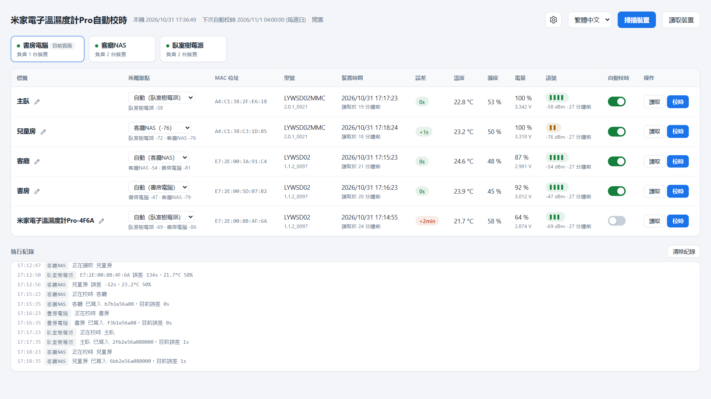
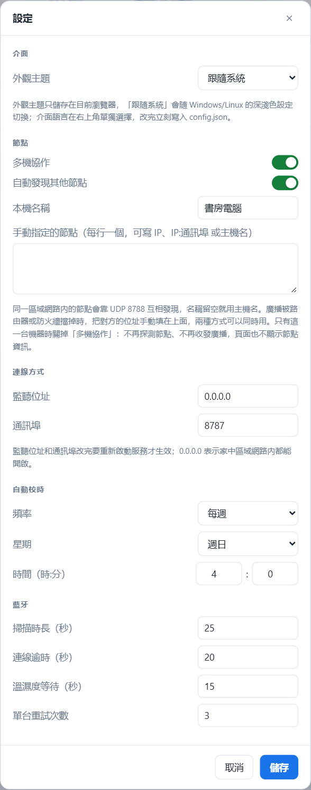

# 米家電子溫濕度計Pro自動校時（LYWSD02 Clock Sync）

[简体中文](README.zh-CN.md) | 繁體中文 | [English](README.md)

讓電腦或 NAS 定期幫小米米家電子紙藍牙溫濕度計校時，不用再每隔一兩個月打開米家 App 手動對一次。

這款裝置不連網，時間只能靠手機上的米家 App 寫入，放著不管一兩個月就會差上幾分鐘。本專案依排程透過低功耗藍牙（BLE）連線到裝置，寫入本機的時間。

- 網頁上一台裝置一列：標籤、MAC、型號、裝置時間、誤差、溫度、濕度、電量、訊號
- 每列都有**讀取**、**校時**按鈕和獨立的自動校時開關
- 定時自動校時（預設每週一次），關機時錯過了，開機後會補上
- 多台機器可以組成叢集涵蓋整個家，在任何一個頁面上都能操作任何一台裝置，由訊號最好的機器去連線
- Windows 是帶圖形介面的 `Setup.exe`，安裝過程即時顯示在視窗中；Linux 是原生 `.deb`，有 amd64 和 arm64 兩種。程式自帶執行環境，不用另外安裝 Python 或執行階段程式庫
- 校時頻率、監聽位址、藍牙逾時都能在網頁的設定中修改
- 介面有简体中文、繁體中文、English，右上角切換
- 深色/淺色主題，預設跟隨系統
- 前端沒有任何相依套件，不用 npm，不走 CDN

<picture>
  <source media="(prefers-color-scheme: dark)" srcset="docs/images/main-zh-TW-dark.png">
  
</picture>

## 目錄

- [支援的作業系統](#支援的作業系統)
- [支援的裝置](#支援的裝置)
- [如何確認你的裝置在支援範圍內](#如何確認你的裝置在支援範圍內)
- [安裝](#安裝)
  - [Windows](#windows)
  - [Debian / Ubuntu / fnOS](#debian--ubuntu--fnos)
  - [驗證安裝結果](#驗證安裝結果)
- [使用](#使用)
- [多台機器組成一個叢集](#多台機器組成一個叢集)
- [管理服務](#管理服務)
- [設定檔](#設定檔)
- [HTTP 介面](#http-介面)
- [工作原理](#工作原理)
- [協定細節](#協定細節)
- [安全性](#安全性)
- [疑難排解](#疑難排解)
- [移除](#移除)
- [從原始碼執行與打包](#從原始碼執行與打包)
- [授權](#授權)

## 支援的作業系統

藍牙部分使用 [bleak](https://github.com/hbldh/bleak)，平台需求和它相同。

| 平台 | 最低需求 | 說明 |
| --- | --- | --- |
| Windows | Windows 10 1709（build 16299），x64 | 建議 Windows 11。ARM64 安裝檔為實驗性質。必須在互動式使用者工作階段中執行，見下文。 |
| Linux | glibc 2.36+、BlueZ 5.43+，amd64 或 arm64 | Debian 12+、Ubuntu 23.04+、Raspberry Pi OS bookworm+、fnOS 等使用 systemd 的 Debian 系發行版。需要能存取 BlueZ 的 D-Bus。 |
| macOS | 10.13 | 沒有安裝檔，只能[從原始碼執行](#從原始碼執行與打包)。理論上可用，未測試。 |

安裝檔已自帶 Python 執行環境。只有從原始碼執行或自己打包才需要 Python 3.10+。

> **Windows：** WinRT 藍牙 API 在 Session 0（Windows 服務所在的工作階段）中無法使用，所以安裝程式註冊的是**登入時**啟動的排程工作，在你的使用者工作階段中執行。不要把它改成 Windows 服務。

> **Linux：** 服務要透過系統 D-Bus 和 BlueZ 通訊。deb 中的 systemd 服務以 `root` 執行，在家用伺服器上最省事。想用一般使用者執行，就把使用者加入 `bluetooth` 群組，再用 `sudo systemctl edit lywsd02-clock-sync` 加上 `User=`。不要直接修改 `/usr/lib/systemd/system` 中的檔案，升級時會被覆蓋。

### 已測試的環境

| 平台 | 掃描 | 讀取時間/感測器 | 寫入時間 |
| --- | --- | --- | --- |
| Windows 11 專業版 25H2 (build 26200.9711) | 通過 | 通過 | 尚未確認 |
| fnOS 1.2.0800 x86_64（基於 Debian） | 尚未測試 | 尚未測試 | 尚未測試 |

歡迎補充其他平台的測試結果。開 issue 時請附上型號和韌體版本（讀取後顯示在**型號**欄）以及頁面底部的執行紀錄。

## 支援的裝置

| 型號 | 產品 ID | 硬體版本 | 已驗證韌體 | 時間資料長度 |
| --- | --- | --- | --- | --- |
| LYWSD02 | `0x045B` | `F2_LN` | `1.1.2_0097` | 5 位元組 |
| LYWSD02MMC | `0x2542` | `F4_QT` | `2.0.1_0021` | 7 位元組 |
| LYWSD02MMC | `0x16E4` | — | — | 靠產品 ID 辨識，未實測 |

都是帶時鐘的方形電子紙「米家藍牙溫濕度計」。兩種資料長度會自動適配：寫入前先讀出目前的值，時區位元組後面的內容原樣寫回。

其他帶 `ebe0ccb0` 服務的小米裝置也許能用：把產品 ID 加到 [`lywsd02.py`](lywsd02.py) 的 `KNOWN_PRODUCT_IDS`，再[從原始碼執行或重新打包](#從原始碼執行與打包)，掃描就能辨識。

**不支援：** LYWSDCGQ（圓形，沒有時鐘）、LYWSD03MMC（螢幕上沒有時鐘），以及米家本身也無法校時的裝置。

## 如何確認你的裝置在支援範圍內

依序做下面三步，以第 3 步為準。三步都只讀，不會寫入裝置。

**1. 在米家裡看型號**

裝置 → 設定（⚙）→ 裝置資訊，型號應為 `LYWSD02` 或 `LYWSD02MMC`。順便記下這一頁的 MAC 位址。

**2. 掃描**

[安裝](#安裝)後開啟網頁，按**掃描裝置**。約 25 秒後表格中應出現一列，MAC 和米家中的一致。

符合以下任一條件就會被辨識：裝置名稱包含 `LYWSD02`；廣播了 `ebe0ccb0` 服務；`fe95` 服務資料中的產品 ID 在上表中。實測的 LYWSD02MMC（`0x2542`）既不廣播名稱也不廣播服務，只能靠產品 ID 辨識。

一直掃不到的話，先看[疑難排解](#疑難排解)中的「掃描只能找到一部分裝置」。還是不行，就用手機上的 nRF Connect 等 BLE 工具找到這個 MAC，看它的 `fe95` 服務資料：第 3、4 個位元組按小端讀就是產品 ID，例如 `30 58 42 25 …` 是 `0x2542`。

**3. 讀取一次**

按這一列的**讀取**。它會連線到裝置，讀出時間、溫度、濕度和電量並算出誤差，但不寫入。只要**裝置時間**有值、**型號**欄顯示了型號和韌體版本，就表示時間特徵 `ebe0ccb7` 存在且格式能辨識，可以校時。它的格式是小端 uint32 的 Unix 時間戳記加一個帶正負號的時區位元組，見[協定細節](#協定細節)。

就算裝置不接受寫入，按**校時**也只會在紀錄中留下一筆失敗，沒有其他影響。

## 安裝

到 [Releases](../../releases) 頁面下載對應平台的安裝檔：

| 平台 | 檔案 |
| --- | --- |
| Windows x64 | `LYWSD02ClockSync-Setup-<版本>-x64.exe` |
| Windows ARM64（實驗性） | `LYWSD02ClockSync-Setup-<版本>-arm64.exe` |
| Debian / Ubuntu / fnOS，x86_64 | `lywsd02-clock-sync_<版本>_amd64.deb` |
| 64 位元 ARM Linux：樹莓派 4/5、ARM 版 NAS 等 | `lywsd02-clock-sync_<版本>_arm64.deb` |

32 位元 ARM 沒有安裝檔，可以[從原始碼執行](#從原始碼執行與打包)。

安裝時只需要選擇通訊埠（Windows 上還要選語言），其他設定都在網頁中修改。升級時直接安裝新版本，設定和裝置標籤都會保留。

### Windows

1. 下載 `LYWSD02ClockSync-Setup-<版本>-x64.exe`，按兩下執行。
2. UAC 視窗按「是」。註冊排程工作和新增防火牆規則需要系統管理員權限。
3. 選擇介面語言、安裝位置和網頁通訊埠，按**安裝**。視窗中會逐項顯示安裝進度，按**顯示詳細資訊**可以查看完整紀錄，裝完按**開啟網頁**。

安裝檔沒有程式碼簽章，第一次執行時 SmartScreen 可能提示「Windows 已保護您的電腦」，按**其他資訊** → **仍要執行**即可。不放心的話可以[自己打包](#從原始碼執行與打包)。

視窗中有兩個選項：

- **登入 Windows 時自動在背景執行**：每次登入時由排程工作啟動。關掉也會註冊工作，只是要從開始功能表開啟程式，按**啟動**才會執行。
- **允許區域網路中的其他裝置存取**：替程式新增一條輸入防火牆規則，開放網頁通訊埠和節點發現用的 UDP 8788。只在本機使用可以關掉。

安裝程式依序執行：

1. 停止正在執行的服務。如果通訊埠上回應的不是本服務，安裝會在這一步停下並提示；
2. 把程式解壓縮到安裝位置，預設是 `%LocalAppData%\Programs\LYWSD02ClockSync`；
3. 把通訊埠和語言寫進資料目錄的 `config.json`，其他設定不變；
4. 建立開始功能表捷徑，登記到「設定 → 應用程式 → 已安裝的應用程式」；
5. 新增防火牆規則 `LYWSD02 Clock Sync`；
6. 註冊並啟動排程工作 `LYWSD02ClockSync`，最多等 30 秒，確認網頁通訊埠有回應。

程式和資料分開存放：設定、裝置標籤和 `server.log` 在 `%LocalAppData%\LYWSD02ClockSync`，升級不會動它，移除時預設也保留。裝在使用者目錄而不是 Program Files，是因為登入工作以一般權限執行，無法寫入 Program Files。

排程工作必須屬於**互動式**使用者。WinRT 藍牙在 Session 0 中無法運作，所以不要以 `SYSTEM` 身分安裝，也不要把工作改成服務。同理，如果在 UAC 視窗中輸入的是另一個系統管理員帳號的密碼，安裝程式會拒絕繼續，否則工作和資料都會裝到那個帳號下。請登入實際使用的帳號，在這個帳號中確認 UAC。

**靜默安裝**適合大量部署。安裝檔一律需要系統管理員權限，請在已提權的終端機中執行，或在跳出的 UAC 中確認：

```powershell
.\LYWSD02ClockSync-Setup-1.0.0-x64.exe --silent --port 8787 --language zh-CN
```

| 參數 | 含義 |
| --- | --- |
| `--silent` | 不顯示視窗，依參數直接安裝 |
| `--dir <目錄>` | 安裝位置 |
| `--port <通訊埠>` | 網頁通訊埠 |
| `--language <代碼>` | 介面語言：`zh-CN`、`zh-TW` 或 `en` |
| `--no-autostart` | 不在登入時自動執行 |
| `--no-firewall` | 不加防火牆規則 |

沒指定的位置、通訊埠和語言沿用已有安裝的值，全新安裝則用預設值；之前關掉了自動執行的，升級後仍然是關的。這些參數在視窗模式下也有效，用來預先填好表單。結束代碼 `0` 表示安裝成功且服務有回應，過程記錄在 `%TEMP%\LYWSD02ClockSync-setup.log`。

### Debian / Ubuntu / fnOS

```bash
sudo apt install ./lywsd02-clock-sync_1.0.0_amd64.deb
```

沒裝 `bluez` 的話 `apt` 會一併裝上。`dpkg -i` 也能裝，但不會安裝建議的相依套件。

裝好後服務 `lywsd02-clock-sync.service` 已經啟動並設為開機自動啟動，網頁位址是 `http://<這台機器>:8787`。

| 路徑 | 內容 |
| --- | --- |
| `/opt/lywsd02-clock-sync/` | 程式本體 |
| `/usr/lib/systemd/system/lywsd02-clock-sync.service` | systemd 服務 |
| `/var/lib/lywsd02-clock-sync/` | 設定、裝置標籤和排程紀錄，由 systemd 的 `StateDirectory=` 管理 |

服務的輸出寫入 journal，所以 Linux 上沒有 `server.log`。

如果 `ufw` 或 `firewalld` 已啟用，安裝時會開放網頁通訊埠（TCP）和節點發現用的 UDP 8788，移除時刪除；都沒啟用就不做任何變更。其他防火牆，包括 NAS 系統內建的圖形介面防火牆，需要你自己開放這兩個通訊埠。開放的是安裝時 `config.json` 中的通訊埠，之後改了通訊埠，防火牆規則也要自己改。

升級：用 `sudo apt install` 安裝新版本的 deb，服務會自動重新啟動，`/var/lib` 中的資料不受影響。

在 fnOS 上先在系統設定中開啟 SSH，用管理員帳號登入後執行上面的指令。fnOS 的檔案管理員通常看不到 `/opt` 和 `/var/lib`，這是正常的。

### 驗證安裝結果

Windows：從開始功能表開啟「米家電子溫濕度計Pro自動校時」，視窗中應顯示「執行中」和網頁位址。也可以用指令檢查：

```powershell
schtasks /Query /TN LYWSD02ClockSync
Invoke-WebRequest http://127.0.0.1:8787/api/state | Select-Object -Expand Content
```

Linux：

```bash
systemctl status lywsd02-clock-sync
journalctl -u lywsd02-clock-sync -n 50
curl -s http://127.0.0.1:8787/api/state
```

## 使用

瀏覽器開啟 `http://<位址>:8787`。

1. 按**掃描裝置**，約 25 秒後附近的裝置會出現在表格中。還沒命名的裝置顯示為 `米家電子溫濕度計Pro-<MAC 後 4 位>`，會隨介面語言變化。
2. 按鉛筆圖示取個名字。標籤以 MAC 儲存，重新啟動和重新掃描都不會遺失。
3. 按**校時**立即寫入時間，**誤差**欄應變成綠色的 `+0s` 或 `-1s`。
4. 要參與定時校時的裝置，保持**自動校時**開關開啟。

頂部顯示本機時間和下次自動校時的時間。底部紀錄顯示所有節點最近 150 筆事件，每筆都標明來自哪個節點。

有多台機器時，表格上方會列出所有節點和各自負責的裝置數，**所屬節點**欄顯示每台裝置歸哪個節點負責，見[多台機器組成一個叢集](#多台機器組成一個叢集)。

語言下拉選單左邊的 ⚙ 會開啟設定：外觀主題、監聽位址和通訊埠、自動校時頻率、藍牙逾時都在這裡。儲存後寫入 `config.json`，改了位址或通訊埠要重新啟動服務，其餘立即生效。外觀主題是例外，它只儲存在瀏覽器中，選「跟隨系統」會跟著 Windows 或 Linux 的深淺色設定切換。

<picture>
  <source media="(prefers-color-scheme: dark)" srcset="docs/images/settings-zh-TW-dark.png">
  
</picture>

右上角的下拉選單可切換简体中文、繁體中文和 English。它單獨放在外面，是因為看不懂介面時，第一件事就是改語言。選擇後立即寫入 `config.json` 的 `language`，之後用任何瀏覽器開啟都是這個語言，Windows 的安裝和管理視窗也會使用它。紀錄在瀏覽器端翻譯，切換語言後已有的紀錄也會一起換。

掃描和連線是依序執行的，因為藍牙介面卡不能同時做這兩件事。請求會排入佇列，頂部顯示目前正在做什麼。

感測器資料只在按**讀取**或**校時**時更新，沒有背景輪詢，因為每次連線都在消耗鈕扣電池。**掃描裝置**旁邊的**讀取裝置**會一次讀取全部裝置：各節點同時讀取自己負責的裝置，全部讀完才釋放鎖。它只讀不寫，也不受自動校時開關影響。

## 多台機器組成一個叢集

一個藍牙介面卡的涵蓋範圍有限。在裝置附近的每台機器上都裝一份，例如臥室的桌機和客廳的家用伺服器，它們會在區域網路中互相發現，作為一個整體運作。沒有主節點，也沒有共用資料庫：每個節點維護自己的 `devices.json`，頁面上顯示的是所有節點已知裝置的聯集。

每個節點只操作本機的藍牙介面卡。在頁面上對另一個節點負責的裝置按**校時**，請求會轉送給那個節點執行。轉送過去的請求不會再次轉送，所以最多只有一跳。

### 節點名稱與發現方式

在設定中替每台機器取個名字，例如「臥室」「客廳」。留空則用主機名稱；儲存時如果欄位中還是主機名稱，存下的仍是空值，以後機器改名，節點名稱會跟著變。這個名字儲存在 `config.json`，顯示在裝置表格和紀錄中。節點的身分是 `state.json` 中的隨機 id，所以把設定檔複製到別的機器上，也不會讓兩個節點被當成同一個。

兩種發現方式同時運作，任何一種通了就行：

| 方式 | 通訊埠 | 什麼時候有效 |
| --- | --- | --- |
| UDP 廣播 | 8788 | 同一子網路且允許廣播時有效，無需設定。150 秒沒有訊息的節點會被移除。 |
| 手動指定 | 網頁通訊埠 | 一律有效。在設定的*手動指定的節點*中填 `192.168.1.20`、`192.168.1.20:8787` 或 `nas`。 |

廣播被擋住時（訪客 VLAN、AP 隔離、防火牆只開放了 TCP 通訊埠）就用手動指定。兩種方式都發現了同一個節點，也只算一個。

有頁面開著時每 10 秒廣播一次，沒人看時 60 秒一次。收到陌生位址的廣播會立即回應一次，所以即使雙方都處在慢速檔，新節點也不用等一分鐘才出現。

節點探測對方時會帶上自己的網頁通訊埠，對方收到後會把它加進自己的清單。所以只要在一台機器上手動填了位址，兩邊就能互相看到；廣播只能單向送出時（例如 NAS 只從一張網路卡往外送）也能連通。8788 通訊埠被占用時只記一筆紀錄，在背景重試，手動指定的節點不受影響。

想在一台機器上試叢集，可以[從原始碼](#從原始碼執行與打包)啟動多份服務：每份用 `LYWSD02_DATA_DIR` 指向不同的資料目錄，目錄中放一個只寫了不同 `port` 的 `config.json`，再把其他幾份的 `127.0.0.1:<通訊埠>` 填進手動指定的節點。它們會像幾台獨立的機器一樣組成叢集，只是只有第一份能占到廣播通訊埠，而且共用同一個藍牙介面卡。安裝檔做不到：服務名稱是固定的，一台機器只能裝一份。

### 哪個節點負責哪台裝置

每個節點都會回報自己收到每台裝置的訊號強度，訊號最強的節點負責這台裝置。比較前訊號按 6 dBm 取整，這樣各節點不用協調就能得出相同的結果，鄰居也必須明顯更近才能搶走歸屬，差一兩個 dBm 不會來回跳。**所屬節點**欄顯示負責的節點，下面是各節點的訊號值。每次掃描會整批取代該節點的資料，掃不到的裝置會從它的清單中移除，不會一直掛著舊訊號。

自動分配不合適的話，直接在這一欄中選一個節點，裝置就固定由它負責。固定後不會因為別處訊號更強而改變，也不會被接手。下拉選單中只有最近一次掃描收到這台裝置的節點，選別的一定連不上；裝置換了位置，請先重新掃描再改。固定負責的節點後來收不到這台裝置時，會標為「掃不到」並保留，直到你改掉。

定時校時按歸屬分工：到了排程時間，每個節點只校自己負責的裝置，三個節點不會在 04:00 把同一台時鐘校三遍。

### 同時只允許一個操作

一台時鐘只該由一台機器寫入，多個介面卡同時運作，紀錄也會亂成一團，所以任何操作都會鎖住整個叢集。發起操作的節點先向所有聯絡得上的節點申請鎖，全部同意後才開始。這段期間其他操作，例如別的頁面上的按鈕、別的節點的定時工作，都會被拒絕，並提示是哪個節點在忙；結束之前所有頁面的按鈕都是灰的。

聯絡不上的節點不參與投票。關著的機器不可能在用藍牙，如果讓它有否決權，一台休眠的電腦就能卡住整個叢集。持鎖節點中途斷線時，鎖會在 30 秒後釋放；工作卡死也最多占用 15 分鐘。

### 某個節點離線時

節點斷線後仍負責原來的裝置，因為它在物理上還是離這些裝置最近的，改派給幾乎收不到訊號的介面卡只會更糟。這些列會顯示離線標記，**讀取**和**校時**按鈕無法使用。

標籤、自動校時開關和指定的節點是例外：它們在任何頁面上都能改，靠時間戳記同步到其他節點，所以節點離線時照樣能改，等它回來後以最後一次修改為準。

負責節點離線超過 26 小時的裝置，會由其他收得到它的節點接手，一台整個週末都關著的電腦不會讓時鐘一直沒人校。指定了節點的裝置不會被接手。

### 用不到的時候關掉

只有一台機器時，用不到叢集功能。設定中有兩個開關，對應 `config.json` 的兩個鍵：

| 開關 | 鍵 | 關掉之後 |
| --- | --- | --- |
| 多機協作 | `node.cluster` | 不再探測節點、不收發廣播、不接受節點間請求（`/api/node/*` 一律回傳 503），頁面也不顯示節點列和**所屬節點**欄 |
| 自動發現其他節點 | `node.discovery` | 叢集照常運作，只是不收發 UDP 廣播、釋放 8788 通訊埠，節點只來自手動指定的清單 |

定時校時也可以關：把排程設為**關閉**，排程器就不會動到藍牙。

其餘省電措施都是自動的：

- 節點探測分三檔：有頁面開著時 2 秒一次，有節點但沒人看時 60 秒一次，從來沒有節點回應過時 300 秒一次。閒置時對每個節點每天的探測次數從 43200 降到 1440。
- 頁面切到背景就停止輪詢，切回來立即更新一次，忘記關的分頁不會一直喚醒那台機器。
- 連續 30 秒以上聯絡不上的節點，最多每分鐘探測一次，不會每次重新整理都去試，關著的機器不會拖慢頁面：有一個節點斷線時，第一個請求從 1.5 秒降到幾毫秒。一旦收到它的廣播或探測，馬上恢復正常。
- 頁面只重繪有變化的部分，一次閒置重新整理的瀏覽器開銷從約 22 毫秒降到約 1 毫秒。
- 探測頻率低只影響表格是否即時，不影響正確性：每次操作、每次申請鎖之前都會先強制探測一輪，不會依過期的節點清單行事。
- 到了排程時間，節點先根據已知資訊判斷有沒有自己要校的裝置，沒有就跳過，不申請鎖也不掃描。唯一的例外是本機藍牙還從沒收到過清單中的任何裝置，這時只有掃描才知道附近有沒有，所以照常掃描。

## 管理服務

**Windows：** 從開始功能表開啟「米家電子溫濕度計Pro自動校時」就是管理視窗，每兩秒更新一次服務狀態：

| 按鈕 | 作用 |
| --- | --- |
| 開啟網頁 | 用預設瀏覽器開啟網頁 |
| 啟動 / 停止 | 啟動或停止排程工作，並等到通訊埠開始回應或已經釋放 |
| 開啟資料目錄 | 開啟 `%LocalAppData%\LYWSD02ClockSync` |
| 移除 | 開啟移除視窗，見[移除](#移除) |

按**啟動**後 25 秒內通訊埠沒有回應會回報失敗，原因看資料目錄中的 `server.log`：服務沒有主控台，啟動時的錯誤都寫在這個檔案中。

也可以直接操作排程工作：

```powershell
schtasks /Run /TN LYWSD02ClockSync      # 啟動
schtasks /End /TN LYWSD02ClockSync      # 停止
```

**Linux：**

```bash
sudo systemctl start lywsd02-clock-sync
sudo systemctl stop lywsd02-clock-sync
sudo systemctl restart lywsd02-clock-sync    # 改了監聽位址或通訊埠之後
sudo systemctl disable lywsd02-clock-sync    # 不再開機自動啟動
journalctl -u lywsd02-clock-sync -f          # 即時查看紀錄
```

## 設定檔

### `config.json`

所有設定項都在這裡。它和下面的 `state.json`、`devices.json` 都放在資料目錄，不在程式目錄：

| 平台 | 資料目錄 |
| --- | --- |
| Windows | `%LocalAppData%\LYWSD02ClockSync` |
| Linux | `/var/lib/lywsd02-clock-sync` |
| 從原始碼執行 | 原始碼目錄本身 |

設定了環境變數 `LYWSD02_DATA_DIR` 時以它為準。

檔案不存在或缺少某些鍵時都用預設值，所以只寫要改的幾項就行。網頁的設定也是寫這個檔案，手動編輯前請先停止服務，否則下次在網頁上儲存會覆蓋你的修改。`host` 和 `port` 重新啟動服務後生效，其餘立即生效。

| 鍵 | 預設值 | 含義 |
| --- | --- | --- |
| `language` | `"zh-CN"` | 網頁及 Windows 安裝、管理視窗的語言，右上角下拉選單也會寫入：`zh-CN`、`zh-TW`、`en` |
| `host` | `"0.0.0.0"` | 監聽位址 |
| `port` | `8787` | 監聽通訊埠 |
| `node.name` | `""` | 本節點在表格和紀錄中的名稱，留空表示用主機名稱 |
| `node.peers` | `[]` | 手動指定的節點，例如 `["192.168.1.20", "nas:8787"]` |
| `node.cluster` | `true` | 關閉即單機模式：不探測節點、不收發廣播、不接受節點間請求 |
| `node.discovery` | `true` | 關閉後只停用 UDP 廣播，手動指定的節點照常使用 |
| `schedule.mode` | `"weekly"` | `weekly`、`daily` 或 `off` |
| `schedule.weekday` | `6` | `0` = 週一 … `6` = 週日 |
| `schedule.hour` | `4` | 本地時間的小時 |
| `schedule.minute` | `0` | 本地時間的分鐘 |
| `bluetooth.scan_timeout` | `25.0` | 每次掃描的秒數 |
| `bluetooth.connect_timeout` | `20.0` | 連線等待秒數 |
| `bluetooth.env_timeout` | `15.0` | 等待感測器通知的秒數 |
| `bluetooth.retries` | `3` | 每台裝置的連線嘗試次數 |

### `state.json`

排程器的紀錄，由服務寫入：`last_auto_run` 是上次自動校時的 Unix 時間戳記，`node_id` 是本節點的隨機身分，`nodes` 是見過的節點 id 和名稱。刪掉它等於清空這些紀錄，不要手動編輯。單獨放一個檔案，是為了不讓排程紀錄碰到你的設定，把 `config.json` 複製到另一台機器時也不會連節點身分一起複製過去。

### `devices.json`

由服務建立和維護。鍵是去掉分隔符號的 MAC 位址，`label` 和 `auto` 由你設定，其餘是最近一次讀取的快取。

```json
{
  "A4C13877596D": {
    "address": "A4:C1:38:77:59:6D",
    "label": "走廊",
    "auto": true,
    "rssi": -67,
    "last": {
      "model": "LYWSD02MMC",
      "firmware": "2.0.1_0021",
      "temperature": 24.13,
      "humidity": 60,
      "drift": -1
    }
  }
}
```

三個檔案都是原子寫入（先寫暫存檔再 `os.replace`），斷電也不會留下寫了一半的檔案。

從原始碼執行時它們就在原始碼目錄中，所以都加進了 `.gitignore`。`devices.json` 中有你的裝置 MAC 位址，不要提交。

## HTTP 介面

| 方法 | 路徑 | 作用 |
| --- | --- | --- |
| `GET` | `/api/state` | 頁面需要的全部資料：裝置、節點、鎖、佇列、排程、紀錄、介面語言 |
| `GET` | `/api/ping` | 只表示服務在執行；和 `/api/state` 不同，它不算「有人在看」 |
| `POST` | `/api/scan` | 排入掃描，本機和所有聯絡得上的節點都掃 |
| `POST` | `/api/read` | 所有聯絡得上的節點讀取各自負責的裝置 |
| `POST` | `/api/devices/{key}/refresh` | 排入時間和感測器讀取 |
| `POST` | `/api/devices/{key}/sync` | 排入時間寫入 |
| `PATCH` | `/api/devices/{key}` | `{"label": "...", "auto": true, "owner_pin": "<節點 id>"}` |
| `POST` | `/api/logs/clear` | 清空記憶體中的執行紀錄 |
| `GET` | `/api/settings` | 設定中能改的設定項 |
| `PUT` | `/api/settings` | 整體儲存，回傳 `{"restart_required": bool}` |
| `PUT` | `/api/language` | 語言下拉選單使用：`{"language": "zh-CN"}` |

`{key}` 是去掉分隔符號的 MAC 位址。排入佇列的 `POST` 立即回傳 `{"queued": true}`，結果從 `/api/state` 查看。屬於其他節點的裝置會轉到那個節點執行，呼叫方不需要處理。

節點之間用另一組範圍更窄的介面，只操作本節點的藍牙、不再轉送，所以請求最多一跳。這些介面是給節點之間使用的，都是一般的 JSON：

| 方法 | 路徑 | 作用 |
| --- | --- | --- |
| `GET` | `/api/node/state` | 本節點自己掌握的資訊 |
| `POST` | `/api/node/lock` | 申請叢集鎖，本節點正忙時拒絕 |
| `POST` | `/api/node/unlock` | 釋放叢集鎖 |
| `POST` | `/api/node/scan` | 用本節點的藍牙掃描，需要持鎖者的權杖 |
| `POST` | `/api/node/read` | 讀取本節點負責的裝置，需要持鎖者的權杖 |
| `POST` | `/api/node/devices/{key}/refresh` | 用本節點的藍牙讀取 |
| `POST` | `/api/node/devices/{key}/sync` | 用本節點的藍牙寫入 |
| `POST` | `/api/node/logs/clear` | 清空本節點的紀錄 |

拒絕時回傳的是文案鍵而不是現成的句子，每個頁面用自己的語言顯示：`{"detail": {"event": "error.clusterBusy", "params": {...}}}`。關閉了多機協作的節點對這組介面一律回傳 503 `error.clusterOff`，對方頁面會顯示對應的提示，不會只顯示「連不上」。

```bash
curl -s http://127.0.0.1:8787/api/state | python -m json.tool
curl -X POST http://127.0.0.1:8787/api/devices/A4C13877596D/sync
curl -X PATCH http://127.0.0.1:8787/api/devices/A4C13877596D \
  -H 'Content-Type: application/json' -d '{"label":"走廊","auto":true}'
```

## 工作原理

```
app.py           程式進入點：serve 啟動服務，Windows 上不帶參數開啟管理視窗
paths.py         程式資源和資料目錄的位置
lywsd02.py       BLE 協定：掃描、產品 ID 比對、時間編解碼、
                 自適應長度寫入、感測器與身分資訊讀取
store.py         JSON 原子寫入
cluster.py       節點身分、節點發現、叢集鎖、歸屬合併
server.py        FastAPI 應用、循序工作佇列、排程器、REST 介面
static/          單頁前端，原生 JS，不請求任何外部資源
  index.html     結構、樣式與渲染
  i18n.js        zh-CN / zh-TW / en 文案
  icon.png       網頁圖示
winsetup.py      Windows 的安裝、管理和移除視窗（tkinter）
packaging/
  build.py       在目前平台打出 Setup.exe 或 .deb
  installer.py   Setup.exe 的進入點
  linux/         systemd 服務和 deb 的維護腳本
  icon.ico       程式圖示
VERSION          版本號，打包和發布都從這裡讀
```

後端不組裝給人看的句子。紀錄以「事件名稱 + 參數」的形式送出（`{"event": "device.synced", "params": {...}}`），由瀏覽器轉成文字，所以切換語言立即生效，文案也只需要維護一份。

藍牙介面卡無法同時掃描和連線，所以 `server.py` 把所有操作放進一個單一消費者的 `asyncio.Queue`。同一台裝置已經在佇列中時，重複的請求會被丟棄。

排程器每分鐘檢查一次，算出排程最近一次應該觸發的時間。如果 `state.json` 中的 `last_auto_run` 早於這個時間就立即執行，所以週日 04:00 關著機的機器開機後會馬上補跑，不用再等一週，效果和 systemd timer 的 `Persistent=true` 一樣。

服務第一次啟動時把 `last_auto_run` 設為目前時間，所以全新安裝不會把上一個排程時間當成錯過的那次立即補跑，第一次自動校時就在下一個排程時間。

`cluster.py` 沒有引入額外的相依套件：節點之間的呼叫是工作執行緒中的 `urllib.request`，節點發現用 UDP 廣播而不用 mDNS，免得在連 PyPI 都很吃力的機器上再多裝一個套件。裝置資料按欄位「最後寫入者為準」合併，兩個節點同時改同一個標籤時，結果以較晚的修改為準，不需要交易。

只有 `/api/state` 的請求算「有人在看」，節點之間的探測不算，否則兩台閒置的機器互相探測，會讓彼此一直處在最快的那一檔。兩個背景迴圈各用各的喚醒事件，如果共用一個，先醒的會把另一個的通知吃掉。

## 協定細節

以下內容都在實機上驗證過。米家時鐘服務是 `ebe0ccb0-7a0a-4b0c-8a1a-6ff2997da3a6`。

### 時間：`ebe0ccb7`

| 位元組 | 型別 | 含義 |
| --- | --- | --- |
| 0–3 | uint32 小端 | Unix 時間戳記，UTC |
| 4 | int8 | 時區偏移，整小時（UTC+8 就是 `0x08`） |
| 5+ | — | LYWSD02MMC 上才有（`0x0000`），讀出後原樣寫回 |

時區欄位只能表示整小時，UTC+5:30 這類偏移要把多出來的部分折進時間戳記：

```python
offset = time.localtime(now).tm_gmtoff
struct.pack("<Ib", int(now) + offset % 3600, offset // 3600)
```

LYWSD02MMC 的 `ebe0ccb7` 屬性是 `[write,read]`，不支援 write-without-response，所以必須用 ATT Write Request（opcode `0x12`，即 bleak 的 `response=True`），不能用 Write Command（`0x52`）。

### 感測器：`ebe0ccc1`

| 位元組 | 型別 | 含義 |
| --- | --- | --- |
| 0–1 | int16 小端 | 溫度 × 100，°C |
| 2 | uint8 | 相對濕度，% |
| 3–4 | uint16 小端 | 電池電壓 × 1000，V |

LYWSD02MMC 可以直接讀；LYWSD02 讀出來是空的，只透過通知回報，所以程式先讀，讀到空資料再改為訂閱通知。

### 其他特徵

| UUID | 含義 |
| --- | --- |
| `ebe0ccc4` | 電量百分比（uint8） |
| `2a24` | 型號，例如 `LYWSD02MMC` |
| `2a25` | 序號，唯一且不變 |
| `2a26` | 韌體版本 |
| `2a27` | 硬體版本，例如 `F4_QT` |
| `2a23` | System ID，前 6 位元組倒過來就是 MAC |

### 裝置識別

`2a00`（Device Name）是唯讀的，無法透過 BLE 改名。米家中的 `裝置 ID`（`blt.3.…`）由小米雲端分配，裝置上讀不到；CMIIT ID 對應的是型號，不是某一台裝置。裝置上唯一穩定的識別是 MAC 位址和序號，所以本專案用 MAC 作為標籤的鍵。

### 不要盲目寫入

`ebe0ccd2` 中存的疑似是配對/綁定碼。往用途不明的特徵中寫資料，可能要在米家中重新配對。本專案只寫 `ebe0ccb7` 這一個特徵，**讀取**按鈕什麼都不寫。

## 安全性

本服務**沒有任何身分驗證**，能存取這個通訊埠的人都能改標籤、改裝置時間。

- `0.0.0.0` 只適合可信任的家用區域網路。
- 其他情況請在設定中把監聽位址改成 `127.0.0.1`（Windows 安裝時也關掉防火牆選項），再透過 SSH 通道存取。
- 不要把這個通訊埠暴露到網際網路，也不要做通訊埠轉送。
- 節點之間同樣沒有驗證，只因為在同一個網路中才互相信任，叢集的安全性取決於你的網路。繫結 `127.0.0.1` 等於關掉叢集，因為聯絡不到別的節點。

小米 `fe95` 加密廣播（bindkey 機制）只影響**被動**解析廣播資料。本專案用的是主動 GATT 讀寫，不需要 bindkey。

## 疑難排解

**按兩下 Setup.exe 後沒反應**

多半是在 UAC 視窗中按了「否」，再按兩下一次即可。如果 SmartScreen 提示「Windows 已保護您的電腦」，按**其他資訊** → **仍要執行**。安裝檔沒有程式碼簽章，下載量還少的新版本都會這樣。

**安裝停在第一步，提示通訊埠上有其他程式在回應**

通訊埠被別的程式占用，多半是從原始碼手動啟動的服務。關掉它，或者換個通訊埠再裝。

**安裝程式提示正以另一個帳號執行**

UAC 視窗中輸入的是另一個系統管理員帳號。排程工作和資料必須屬於實際使用的帳號，請登入那個帳號，在它的工作階段中確認 UAC。

**本機能開啟頁面，其他機器打不開**

在設定中確認監聽位址是 `0.0.0.0` 而不是 `127.0.0.1`，再檢查防火牆規則：Windows 用 `netsh advfirewall firewall show rule name="LYWSD02 Clock Sync"`，沒有就重新執行一次 Setup 並打開防火牆選項；Linux 用 `ufw status` 或 `firewall-cmd --list-ports`，NAS 內建的防火牆要到它的管理介面中查看。

**另一個節點一直不出現在節點列中**

先在瀏覽器中開啟 `http://<另一台機器>:8787/api/node/state`。打不開就是網路不通，和發現機制無關。回傳 503 `error.clusterOff` 表示那台機器關了**多機協作**，到它的設定中開啟。能開啟但節點還是不出現，就是 UDP 廣播被擋了，例如 AP 隔離、訪客 VLAN，或防火牆只開放了 TCP 通訊埠。把那台機器的位址填進設定的*手動指定的節點*，這條路走網頁通訊埠，不依賴廣播。

**掃描只能找到一部分裝置**

米家 App 在前景或剛切到背景時會占著連線。把附近所有手機上的米家都強制停止，在設定中把「掃描時長」調到 40 秒再掃一次。裝置正被其他連線占用時不會回應掃描。

**連線時出現 `BleakDeviceNotFoundError`**

裝置要先被掃描到才能連線。服務每次連線前都會重新尋找一次位址，找不到才直接用位址嘗試。Linux 上如果看到的是 `BleakError("device 'dev_A4_C1_38_..' not found")`，是 BlueZ 已經把這台未配對的裝置從 D-Bus 中移除了（停止掃描約半分鐘後就會移除），重新尋找即可，不必重新啟動服務。

**Linux 上完全掃不到裝置**

```bash
bluetoothctl list                 # 有藍牙控制器嗎？
systemctl status bluetooth        # BlueZ 在執行嗎？
rfkill list bluetooth             # 是否被軟體封鎖？
```

服務以非 root 使用者執行時需要 BlueZ 的 D-Bus 權限：把使用者加入 `bluetooth` 群組，或者用 root 執行。

**Windows 重新開機後服務沒有執行**

排程工作在**登入時**觸發，不是開機時；安裝時關掉了「登入 Windows 時自動在背景執行」的話，它不會自己啟動。用 `schtasks /Query /TN LYWSD02ClockSync /V /FO LIST` 檢查。不登入就執行是行不通的，WinRT 藍牙在 Session 0 中基本上無法使用。

**裝好了，但瀏覽器顯示「拒絕連線」**

服務註冊了，但沒有在監聽。Windows 上先在管理視窗中按**啟動**，還不行就查：

```powershell
Get-ScheduledTask LYWSD02ClockSync | Get-ScheduledTaskInfo           # 執行過嗎？傳回值是多少？
Get-Content "$env:LOCALAPPDATA\LYWSD02ClockSync\server.log" -Tail 40   # 為什麼結束了？
```

Linux 上看 `journalctl -u lywsd02-clock-sync -n 50`。

**誤差校正後很快又出現**

先檢查本機的時間，裝置最多只能和寫入它的機器一樣準。確認已啟用 NTP（Windows 用 `w32tm /query /status`，Linux 用 `timedatectl`）。

**校時後誤差仍然很大**

寫入成功但讀回來還是不對，可能是資料長度和預期不符。請把型號、韌體版本和執行紀錄貼到 issue 中。

**溫濕度一直是空的**

LYWSD02 讀 `ebe0ccc1` 回傳的是空資料，只會按自己的節奏發送通知。如果紀錄中一直出現`溫濕度讀取失敗`，在設定中把「溫濕度等待」調大一些。讀不到溫濕度不影響校時。

**電子紙顯示有延遲**

電子紙按自己的節奏更新，以 BLE 讀回的值為準，螢幕一般一分鐘內會跟上。

## 移除

**Windows：** 在「設定 → 應用程式 → 已安裝的應用程式」中找到它並解除安裝，或者在管理視窗中按**移除**。移除會停止服務，刪除排程工作、防火牆規則、開始功能表捷徑和移除項目，最後刪除程式檔案。因為程式自己正在執行，最後這一步要等視窗關閉後才完成。

打開「同時刪除設定和裝置資料」會把 `%LocalAppData%\LYWSD02ClockSync` 一起刪掉；關著則保留，重新安裝後接著用。你自己放進程式目錄的檔案不會被刪，這種情況下目錄也會保留。

靜默移除同樣需要系統管理員權限，沒有的話會跳出 UAC：

```powershell
& "$env:LOCALAPPDATA\Programs\LYWSD02ClockSync\LYWSD02ClockSync.exe" uninstall --silent           # 保留資料
& "$env:LOCALAPPDATA\Programs\LYWSD02ClockSync\LYWSD02ClockSync.exe" uninstall --silent --purge   # 連資料一起刪
```

過程記錄在 `%TEMP%\LYWSD02ClockSync-uninstall.log`。

**Linux：**

```bash
sudo apt remove lywsd02-clock-sync    # 保留 /var/lib/lywsd02-clock-sync
sudo apt purge lywsd02-clock-sync     # 連資料一起刪
```

兩種方式都會停止並停用服務，刪除安裝時新增的 `ufw` / `firewalld` 規則。

本專案不寫入系統層級的登錄檔，除了時間之外不會變更裝置上的任何東西。

## 從原始碼執行與打包

### 從原始碼執行

需要 Python 3.10+。Linux 上還需要 BlueZ，而且執行的使用者要能存取它（root 或 `bluetooth` 群組）。

```bash
python -m venv .venv
.venv/bin/pip install -r requirements.txt      # Windows：.venv\Scripts\pip
.venv/bin/python app.py serve                  # Windows：.venv\Scripts\python
```

資料檔案放在原始碼目錄，可以用環境變數 `LYWSD02_DATA_DIR` 換個位置。Windows 上 `python app.py` 不帶參數開啟的是管理視窗，它管理的是已安裝的那一份，不是原始碼這一份。

### 打包

```bash
python packaging/build.py
```

腳本會建立獨立的虛擬環境 `build/venv`，在裡面裝好相依套件和 PyInstaller 再打包，本機的其他 Python 套件不會混進安裝檔。產物在 `dist/`：

| 平台 | 產物 |
| --- | --- |
| Windows | `LYWSD02ClockSync-Setup-<版本>-<x64\|arm64>.exe`，約 34 MB |
| Linux | `lywsd02-clock-sync_<版本>_<amd64\|arm64>.deb` |

PyInstaller 不支援交叉編譯，每種架構都要在對應架構的機器上打包。

**Windows** 需要 python.org 的 Python 3.10+（建議 3.13），安裝 Python 時保留預設勾選的 tcl/tk，安裝和管理視窗用的是 tkinter。

**Linux** 的 deb 相依於打包機器的 glibc 版本，所以要在**最舊的目標系統**上打包。在 Debian 12（glibc 2.36）上打出的套件可以裝在 Debian 12+、Ubuntu 23.04+、樹莓派 OS bookworm 和 fnOS 上：

```bash
sudo apt install python3 python3-venv python3-dev binutils
python3 packaging/build.py
```

手邊沒有 Debian 12 的話可以用 Docker。arm64 的套件要在 arm64 機器上執行這條指令：

```bash
docker run --rm -v "$PWD":/src -w /src debian:12 sh -c \
  "apt-get update && apt-get install -y python3 python3-venv python3-dev binutils && python3 packaging/build.py"
```

| 環境變數 | 作用 |
| --- | --- |
| `PIP_INDEX_URL` | pip 鏡像，例如 `https://pypi.tuna.tsinghua.edu.cn/simple` |
| `DEB_MAINTAINER` | deb 的 `Maintainer` 欄位，例如 `Name <you@example.com>` |
| `DEB_HOMEPAGE` | deb 的 `Homepage` 欄位 |

## 致謝

藍牙部分基於 [bleak](https://github.com/hbldh/bleak)。`ebe0ccb7` 的時間格式早已由小米 BLE 逆向社群記錄，本專案在 LYWSD02 和 LYWSD02MMC 實機上做了驗證，並補上了 7 位元組的版本。

本專案為非官方專案，與小米公司無關。

## 授權

[MIT](LICENSE)
