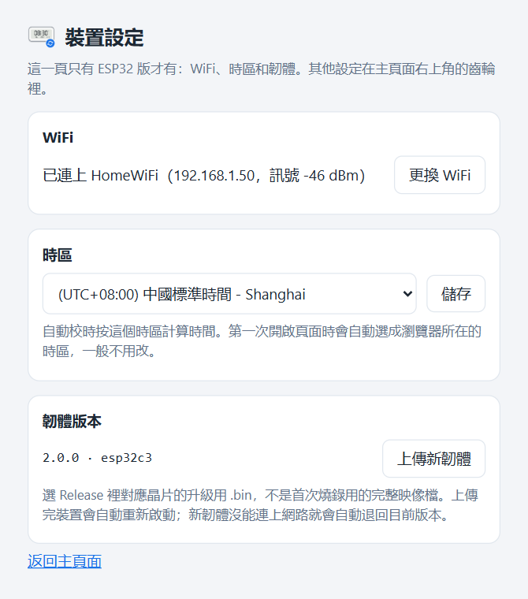

# 米家電子溫濕度計Pro自動校時（LYWSD02 Clock Sync）

[简体中文](README.zh-CN.md) | 繁體中文 | [English](README.md)

米家電子紙藍牙溫濕度計不連網，時間只能靠米家 App 寫入，放一兩個月就會差上幾分鐘。本專案透過低功耗藍牙（BLE）定期替它校時，可以裝在電腦、NAS 上，也可以燒錄到一塊 ESP32-C3 開發板。

- 網頁上一台裝置一列：裝置時間、誤差、溫度、濕度、電量、訊號，每列都能單獨讀取、校時
- 定時自動校時，預設每週一次，關機時錯過的會在開機後補上
- 校時用的時間可以取本機時鐘，也可以取指定的 NTP 伺服器
- 支援 Windows、Linux（包括 fnOS 等 NAS）和 ESP32-C3，安裝檔自帶執行環境
- 多台機器自動組成叢集，每台裝置由訊號最好的那台去連線，任何一個頁面都能操作全部裝置
- 简体中文、繁體中文、English，深色/淺色主題

<picture>
  <source media="(prefers-color-scheme: dark)" srcset="docs/images/main-zh-TW-dark.png">
  
</picture>

## 目錄

- [支援的裝置](#支援的裝置)
- [執行環境](#執行環境)
- [安裝](#安裝)
- [使用](#使用)
- [多台機器組成叢集](#多台機器組成叢集)
- [管理服務](#管理服務)
- [設定檔](#設定檔)
- [HTTP 介面](#http-介面)
- [協定](#協定)
- [安全性](#安全性)
- [常見問題](#常見問題)
- [移除](#移除)
- [從原始碼執行](#從原始碼執行)

## 支援的裝置

| 型號 | 產品 ID | 硬體版本 | 已驗證韌體 | 時間資料長度 |
| --- | --- | --- | --- | --- |
| LYWSD02 | `0x045B` | `F2_LN` | `1.1.2_0097` | 5 位元組 |
| LYWSD02MMC | `0x2542` | `F4_QT` | `2.0.1_0021` | 7 位元組 |
| LYWSD02MMC | `0x16E4` | — | — | 靠產品 ID 辨識，未實測 |

都是帶時鐘的方形電子紙「米家藍牙溫濕度計」。兩種資料長度會自動適配。

不支援 LYWSDCGQ（圓形，沒有時鐘）和 LYWSD03MMC（螢幕上沒有時鐘）。

不確定自己的裝置能不能用，可以這樣確認，全程只讀，不會寫入裝置：

1. 在米家 App 的裝置資訊中看型號，應為 `LYWSD02` 或 `LYWSD02MMC`，順便記下 MAC 位址。
2. 安裝後開啟網頁，按**掃描裝置**，約 25 秒後表格中應出現這個 MAC。
3. 按這一列的**讀取**。**裝置時間**和**型號**欄都有值，就表示可以校時。

掃不到的話先看[常見問題](#常見問題)。

## 執行環境

| 平台 | 需求 | 說明 |
| --- | --- | --- |
| Windows | Windows 10 1709 以上，x64 | ARM64 安裝檔為實驗性質。服務在登入後的使用者工作階段中執行 |
| Linux | glibc 2.36+、BlueZ 5.43+，amd64 或 arm64 | Debian 12+、Ubuntu 23.04+、Raspberry Pi OS bookworm+、fnOS 等使用 systemd 的發行版 |
| ESP32 | ESP32-C3，4 MB Flash | 只支援 2.4 GHz WiFi。一鍵燒錄腳本需要一台 Windows 電腦 |
| macOS | — | 沒有安裝檔，可以[從原始碼執行](#從原始碼執行)，未測試 |

## 安裝

到 [Releases](../../releases) 下載對應的檔案：

| 平台 | 檔案 |
| --- | --- |
| Windows x64 | `LYWSD02ClockSync-Setup-<版本>-x64.exe` |
| Windows ARM64（實驗性） | `LYWSD02ClockSync-Setup-<版本>-arm64.exe` |
| Linux x86_64 | `lywsd02-clock-sync_<版本>_amd64.deb` |
| Linux 64 位元 ARM（樹莓派 4/5、ARM NAS 等） | `lywsd02-clock-sync_<版本>_arm64.deb` |
| ESP32-C3 | `LYWSD02-Clock-Sync-ESP32-<版本>-windows.zip` |

升級時直接安裝新版本，設定和裝置標籤都會保留。叢集中的機器請升級到同一版本。

### Windows

1. 按兩下 `LYWSD02ClockSync-Setup-<版本>-x64.exe`，UAC 視窗按「是」。
2. 選擇介面語言、安裝位置和網頁通訊埠，按**安裝**。
3. 裝完按**開啟網頁**。

安裝檔沒有程式碼簽章，SmartScreen 提示「Windows 已保護您的電腦」時，按**其他資訊** → **仍要執行**。

視窗中的兩個選項：

- **登入 Windows 時自動在背景執行**：關掉後要從開始功能表開啟程式，手動按**啟動**。
- **允許區域網路中的其他裝置存取**：新增防火牆規則，開放網頁通訊埠和節點發現用的 UDP 8788。只在本機使用可以關掉。

程式預設裝在 `%LocalAppData%\Programs\LYWSD02ClockSync`，設定和資料在 `%LocalAppData%\LYWSD02ClockSync`。

服務是登入時啟動的排程工作，不是 Windows 服務，因為 Windows 的藍牙介面在服務所在的 Session 0 中無法使用。所以請在平常使用的帳號中安裝，UAC 也不要輸入別的系統管理員帳號。

大量部署可以靜默安裝，需要系統管理員權限：

```powershell
.\LYWSD02ClockSync-Setup-<版本>-x64.exe --silent --port 8787 --language zh-TW
```

| 參數 | 含義 |
| --- | --- |
| `--silent` | 不顯示視窗，直接安裝 |
| `--dir <目錄>` | 安裝位置 |
| `--port <通訊埠>` | 網頁通訊埠 |
| `--language <代碼>` | `zh-CN`、`zh-TW` 或 `en` |
| `--no-autostart` | 不在登入時自動執行 |
| `--no-firewall` | 不加防火牆規則 |

沒指定的項目沿用已有安裝的值。結束代碼 `0` 表示安裝成功且服務有回應，紀錄在 `%TEMP%\LYWSD02ClockSync-setup.log`。

### Linux

```bash
sudo apt install ./lywsd02-clock-sync_<版本>_amd64.deb
```

`apt` 會一併裝上 `bluez`。裝好後服務 `lywsd02-clock-sync` 已啟動並設為開機自動啟動，網頁位址是 `http://<這台機器>:8787`。

| 路徑 | 內容 |
| --- | --- |
| `/opt/lywsd02-clock-sync/` | 程式 |
| `/var/lib/lywsd02-clock-sync/` | 設定和裝置資料 |

紀錄寫入 journal，用 `journalctl -u lywsd02-clock-sync` 查看。

啟用了 `ufw` 或 `firewalld` 的話，安裝時會自動開放網頁通訊埠和 UDP 8788，移除時刪除。之後改了通訊埠，用 `sudo apt install --reinstall` 重新安裝一次即可更新規則。NAS 內建的防火牆需要自己開放這兩個通訊埠。

服務以 root 執行。想換成一般使用者，把使用者加入 `bluetooth` 群組，再用 `sudo systemctl edit lywsd02-clock-sync` 加上 `User=`。

fnOS 上先在系統設定中開啟 SSH，用管理員帳號登入後執行上面的指令。

### ESP32-C3

燒好的板子插在 USB 充電頭上就能獨立運作，功能和電腦版一樣，也能和電腦版組成叢集。

1. 解壓縮 `LYWSD02-Clock-Sync-ESP32-<版本>-windows.zip`。
2. 用能傳資料的 USB 線把板子接到 Windows 電腦上，按兩下 `flash.bat`。腳本會自動尋找序列埠、寫入韌體，再詢問 WiFi 名稱和密碼，透過 USB 交給板子。也可以先把 `wifi.example.txt` 複製成 `wifi.txt` 填好，用完刪掉。
3. 連上後視窗中會顯示網頁位址，例如 `http://192.168.1.50:8787/`。也可以用 `http://ESP32-C3-XXXX.local:8787/` 開啟，`XXXX` 是 MAC 位址末 4 位。

提示找不到序列埠或無法辨識晶片時，按住板子上的 BOOT 鍵重新接上 USB，再執行一次。

不用電腦也能設定網路：板子還沒設定 WiFi，或者已設定的 WiFi 連續 3 分鐘連不上時，會開啟一個沒有密碼、名稱和主機名稱相同的熱點。手機連上後開啟 `http://192.168.4.1/`，選擇家裡的 WiFi 並輸入密碼。

ESP32 版多一個裝置設定頁 `http://<板子位址>:8787/config`，主頁面的設定中也有入口：

- **WiFi**：查看連線狀態和訊號，更換網路或主機名稱。
- **時區**：自動校時按這個時區計算，第一次開啟頁面時會自動選成瀏覽器所在的時區。
- **韌體版本**：升級時選 `firmware` 目錄中的 `-ota.bin` 上傳，設定都會保留。新韌體連不上網路會自動退回原來的版本。

<picture>
  <source media="(prefers-color-scheme: dark)" srcset="docs/images/config-zh-TW-dark.png">
  
</picture>

重新執行 `flash.bat` 會寫入完整映像檔，清空所有設定，等於恢復原廠設定。`flash.bat -NoFlash` 只更換 WiFi，不重新燒錄。`monitor.bat` 用來查看序列埠紀錄和輸入除錯指令，用法見壓縮檔中的 `README.txt`。

不用 Windows 的話，可以用 [esptool](https://github.com/espressif/esptool) 把完整映像檔寫到 `0x0`，再用手機連熱點設定網路：

```bash
esptool --chip esp32c3 write-flash 0x0 lywsd02-clock-sync-<版本>-esp32c3-full.bin
```

## 使用

瀏覽器開啟 `http://<位址>:8787`。

1. 按**掃描裝置**，約 25 秒後附近的裝置會出現在表格中。
2. 按鉛筆圖示取個名字。名字以 MAC 儲存，重新掃描也不會遺失。
3. 按**校時**立即寫入時間，**誤差**欄變成綠色的 `+0s` 或 `-1s` 就成功了。
4. 要參與定時校時的裝置，保持**自動校時**開關開啟。

**讀取裝置**一次讀取所有裝置的時間、溫濕度和電量，只讀不寫。感測器資料只在讀取或校時時更新，沒有背景輪詢，因為每次連線都在消耗鈕扣電池。

藍牙同一時間只能做一件事，所以掃描、讀取、校時會排隊執行，頂部顯示目前進度。頁面底部是各節點的執行紀錄。

右上角切換介面語言，旁邊的齒輪開啟設定：外觀主題、節點、監聽位址和通訊埠、自動校時頻率、時間來源、藍牙逾時。改了監聽位址或通訊埠需要重新啟動服務，其餘儲存後立即生效。外觀主題只儲存在目前的瀏覽器中。

<picture>
  <source media="(prefers-color-scheme: dark)" srcset="docs/images/settings-zh-TW-dark.png">
  
</picture>

**時間來源**預設用本機時鐘。本機時間不準或者不方便調整，可以選一個 NTP 伺服器，例如阿里雲、騰訊雲、中國國家授時中心，每次讀取和校時前會先向它對時。伺服器連不上時這次校時會略過，並記一筆紀錄。

## 多台機器組成叢集

一個藍牙介面卡的涵蓋範圍有限。在不同房間的電腦、NAS 或 ESP32 上各裝一份，它們會在區域網路中互相發現，作為一個整體運作。沒有主節點，每個節點儲存自己的資料，頁面上顯示所有節點裝置的聯集。

叢集中的節點請保持同一版本。

### 發現其他節點

| 方式 | 通訊埠 | 說明 |
| --- | --- | --- |
| UDP 廣播 | 8788 | 同一子網路內自動發現，不用設定 |
| 手動指定 | 網頁通訊埠 | 在設定的**手動指定的節點**中填 `192.168.1.20`、`192.168.1.20:8787` 或主機名稱 |

路由器開了 AP 隔離、訪客網路或者防火牆擋住廣播時，用手動指定。只要在一台機器上填了對方位址，兩邊就能互相看到。

每個節點的名稱在設定的**本機名稱**中修改，留空用主機名稱。表格上方的節點卡片顯示每個節點負責幾台裝置，點卡片開啟那個節點的頁面。

### 哪個節點負責哪台裝置

每台裝置由收到它訊號最強的節點負責，**所屬節點**欄顯示是哪一個。訊號按 6 dBm 取整再比較，差一兩個 dBm 不會來回切換。也可以在這一欄中直接選一個節點，固定由它負責。

在任何頁面上對某台裝置按**校時**，請求都會轉給負責它的節點執行。定時校時時，每個節點只校自己負責的裝置，同一台時鐘不會被校好幾遍。

### 同一時間只有一個操作

任何操作都會鎖住整個叢集，結束前其他頁面的按鈕都是灰的，別的節點的定時工作也會等待。聯絡不上的節點不參與，關機的電腦不會卡住叢集。持鎖的節點中途斷線，鎖會在 30 秒後釋放。

### 節點離線時

離線節點負責的裝置仍歸它，這些列的**讀取**、**校時**按鈕無法使用。標籤和自動校時開關在任何頁面上都能改，節點回來後自動同步。

負責節點離線超過 26 小時，裝置會由其他收得到它訊號的節點接手。固定了節點的裝置不會被接手。

### 只有一台機器時

在設定中關掉**多機協作**，就不再探測節點、不收發廣播，頁面也不顯示節點資訊。只想停用 UDP 廣播、保留手動指定的節點，就只關**自動發現其他節點**。

沒人開啟頁面時，節點之間的探測會自動放慢，閒置時幾乎不占資源。

## 管理服務

**Windows**：從開始功能表開啟「米家電子溫濕度計Pro自動校時」，視窗中可以開啟網頁、啟動或停止服務、開啟資料目錄、移除。啟動失敗的原因寫在資料目錄的 `server.log` 中。

也可以用指令：

```powershell
schtasks /Run /TN LYWSD02ClockSync      # 啟動
schtasks /End /TN LYWSD02ClockSync      # 停止
```

**Linux**：

```bash
sudo systemctl restart lywsd02-clock-sync    # 重新啟動
sudo systemctl stop lywsd02-clock-sync       # 停止
journalctl -u lywsd02-clock-sync -f          # 即時紀錄
```

**ESP32**：在 `/config` 頁查看狀態，或者用 `monitor.bat` 查看序列埠紀錄。斷電重新接上即重新啟動。

## 設定檔

網頁上的設定都寫在資料目錄的 `config.json` 中，一般不需要手動修改。要改的話先停止服務，只寫需要改的鍵就行，缺少的鍵用預設值。ESP32 的設定儲存在板子上，只能在網頁中修改。

| 平台 | 資料目錄 |
| --- | --- |
| Windows | `%LocalAppData%\LYWSD02ClockSync` |
| Linux | `/var/lib/lywsd02-clock-sync` |
| 從原始碼執行 | 原始碼目錄，或環境變數 `LYWSD02_DATA_DIR` 指定的目錄 |

| 鍵 | 預設值 | 含義 |
| --- | --- | --- |
| `language` | `"zh-CN"` | 介面語言：`zh-CN`、`zh-TW`、`en` |
| `host` | `"0.0.0.0"` | 監聽位址，修改後需重新啟動 |
| `port` | `8787` | 網頁通訊埠，修改後需重新啟動 |
| `node.name` | `""` | 節點名稱，留空用主機名稱 |
| `node.peers` | `[]` | 手動指定的節點，例如 `["192.168.1.20", "nas:8787"]` |
| `node.cluster` | `true` | 多機協作 |
| `node.discovery` | `true` | UDP 廣播發現 |
| `schedule.mode` | `"weekly"` | `weekly`、`daily` 或 `off` |
| `schedule.weekday` | `6` | `0` 是週一，`6` 是週日 |
| `schedule.hour` | `4` | 小時，本地時間 |
| `schedule.minute` | `0` | 分鐘 |
| `time_server` | `""` | 時間來源，留空為本機時鐘，也可以填 NTP 伺服器，例如 `"ntp.aliyun.com"` |
| `bluetooth.scan_timeout` | `25.0` | 掃描時長，秒 |
| `bluetooth.connect_timeout` | `20.0` | 連線逾時，秒 |
| `bluetooth.env_timeout` | `15.0` | 溫濕度等待，秒 |
| `bluetooth.retries` | `3` | 每台裝置的連線嘗試次數 |

同目錄還有兩個由服務維護的檔案，不要手動編輯：`devices.json` 存裝置的標籤、開關和最近一次讀數，`state.json` 存節點身分和上次自動校時的時間。把 `config.json` 複製到別的機器不會帶走節點身分。

## HTTP 介面

| 方法 | 路徑 | 作用 |
| --- | --- | --- |
| `GET` | `/api/state` | 裝置、節點、佇列和排程 |
| `POST` | `/api/scan` | 所有節點掃描 |
| `POST` | `/api/read` | 所有節點讀取各自負責的裝置 |
| `POST` | `/api/devices/{key}/refresh` | 讀取一台裝置 |
| `POST` | `/api/devices/{key}/sync` | 替一台裝置校時 |
| `PATCH` | `/api/devices/{key}` | 修改 `label`、`auto`、`owner_pin` |
| `POST` | `/api/logs` | 取得紀錄，請求本文 `{}` 取最近的紀錄 |
| `POST` | `/api/logs/clear` | 清空紀錄 |
| `GET` / `PUT` | `/api/settings` | 讀取或儲存設定 |
| `PUT` | `/api/language` | 切換介面語言 |

`{key}` 是去掉冒號的 MAC 位址。排隊類的請求立即回傳，結果從 `/api/state` 和紀錄中查看。屬於其他節點的裝置會自動轉過去執行。`/api/node/*` 是節點之間使用的介面。ESP32 另有 `/api/wifi`、`/api/timezone`、`/api/ota`，供裝置設定頁使用。

```bash
curl -s http://127.0.0.1:8787/api/state
curl -X POST http://127.0.0.1:8787/api/devices/A4C138000001/sync
curl -X PATCH http://127.0.0.1:8787/api/devices/A4C138000001 \
  -H 'Content-Type: application/json' -d '{"label":"臥室","auto":true}'
```

## 協定

以下內容都在實機上驗證過。時鐘服務是 `ebe0ccb0-7a0a-4b0c-8a1a-6ff2997da3a6`。

**時間 `ebe0ccb7`**

| 位元組 | 型別 | 含義 |
| --- | --- | --- |
| 0–3 | uint32 小端 | Unix 時間戳記，UTC |
| 4 | int8 | 時區，整小時，UTC+8 為 `0x08` |
| 5–6 | — | 只有 LYWSD02MMC 有，讀出後原樣寫回 |

非整小時的時區（如 UTC+5:30）把多出的部分折進時間戳記。LYWSD02MMC 只接受帶回應的寫入（ATT Write Request）。

**溫濕度 `ebe0ccc1`**

| 位元組 | 型別 | 含義 |
| --- | --- | --- |
| 0–1 | int16 小端 | 溫度 × 100，°C |
| 2 | uint8 | 相對濕度，% |
| 3–4 | uint16 小端 | 電池電壓 × 1000，V |

LYWSD02 讀這個特徵是空的，只透過通知回報。

**其他**：`ebe0ccc4` 電量百分比，`2a24` 型號，`2a26` 韌體版本，`2a27` 硬體版本，`2a25` 序號。

裝置名稱無法透過 BLE 修改，米家 App 中的裝置 ID 由雲端分配、裝置上讀不到，所以本專案用 MAC 區分裝置。本專案只寫 `ebe0ccb7` 這一個特徵，**讀取**什麼都不寫。

## 安全性

服務沒有身分驗證，能存取通訊埠的人都能改標籤和裝置時間。節點之間也沒有驗證。

- 只在可信任的家用區域網路中使用，不要暴露到網際網路或做通訊埠轉送。
- 只在本機使用的話，把監聽位址改成 `127.0.0.1`，這時叢集也就無法使用了。

本專案用的是主動連線讀寫，不需要小米的 bindkey。

## 常見問題

**掃描只能找到一部分裝置**

手機上的米家 App 在前景時會占著連線。把附近手機上的米家都關掉，在設定中把掃描時長調到 40 秒再掃一次。裝置離得太遠也會掃不到，可以在離它更近的機器上再裝一個節點。

**Linux 上完全掃不到裝置**

```bash
bluetoothctl list               # 有藍牙控制器嗎
systemctl status bluetooth      # BlueZ 在執行嗎
rfkill list bluetooth           # 是否被封鎖
```

**本機能開啟頁面，其他機器打不開**

確認設定中的監聽位址是 `0.0.0.0`，再檢查防火牆。Windows 上重新執行一次 Setup 並勾選允許區域網路存取；Linux 上看 `ufw status` 或 `firewall-cmd --list-ports`。

**另一個節點一直不出現**

先在瀏覽器中開啟 `http://<另一台機器>:8787/api/state`。打不開是網路或防火牆的問題；能開啟就是廣播被擋了，把它的位址填進**手動指定的節點**。

**Windows 重新開機後服務沒有執行**

服務在登入時啟動，不是開機時。確認安裝時勾選了「登入 Windows 時自動在背景執行」，或從開始功能表開啟程式按**啟動**。

**校時後很快又有誤差**

裝置只能和寫入它的時間一樣準。檢查本機是否開啟了自動校時，或者在設定中把時間來源改成 NTP 伺服器。

**溫濕度一直是空的**

LYWSD02 只按自己的節奏發送通知，在設定中把溫濕度等待調大一些。讀不到溫濕度不影響校時。

**ESP32 的網頁打不開**

確認手機或電腦和板子在同一個區域網路。有的路由器不支援 `.local` 位址，改用 IP 開啟；IP 可以在路由器管理頁面查，或者在 `monitor.bat` 中輸入 `info`。

**ESP32 一直開著熱點**

表示連不上 WiFi：密碼不對、是 5 GHz 網路，或者離路由器太遠。連上熱點重新設定網路，或者執行 `flash.bat -NoFlash`。

## 移除

**Windows**：在「設定 → 應用程式 → 已安裝的應用程式」中解除安裝，或在管理視窗中按**移除**。勾選「同時刪除設定和裝置資料」會刪掉資料目錄，不勾則保留。靜默移除：

```powershell
& "$env:LOCALAPPDATA\Programs\LYWSD02ClockSync\LYWSD02ClockSync.exe" uninstall --silent          # 保留資料
& "$env:LOCALAPPDATA\Programs\LYWSD02ClockSync\LYWSD02ClockSync.exe" uninstall --silent --purge  # 刪除資料
```

**Linux**：

```bash
sudo apt remove lywsd02-clock-sync    # 保留資料
sudo apt purge lywsd02-clock-sync     # 刪除資料
```

**ESP32**：重新執行 `flash.bat` 清空設定，或者直接拔掉。

## 從原始碼執行

需要 Python 3.10+。Linux 上執行的使用者要能存取 BlueZ（root 或 `bluetooth` 群組）。

```bash
python -m venv .venv
.venv/bin/pip install -r requirements.txt      # Windows：.venv\Scripts\pip
.venv/bin/python app.py serve                  # Windows：.venv\Scripts\python
```

自己打包安裝檔執行 `python packaging/build.py`，產物在 `dist/`。PyInstaller 不能跨平台編譯，每種平台和架構要在對應的機器上打包。deb 請在 Debian 12 上打包，這樣能裝在所有 glibc 2.36+ 的系統上。

ESP32 韌體用 ESP-IDF v6.0.3 編譯：

```bash
cd esp32/node
idf.py set-target esp32c3
idf.py build
```

## 致謝

藍牙部分基於 [bleak](https://github.com/hbldh/bleak)，ESP32 版基於 ESP-IDF 和 NimBLE。`ebe0ccb7` 的時間格式早已由小米 BLE 逆向社群記錄，本專案在 LYWSD02 和 LYWSD02MMC 實機上做了驗證，並補上了 7 位元組的版本。

本專案為非官方專案，與小米公司無關。

## 授權條款

[MIT](LICENSE)
